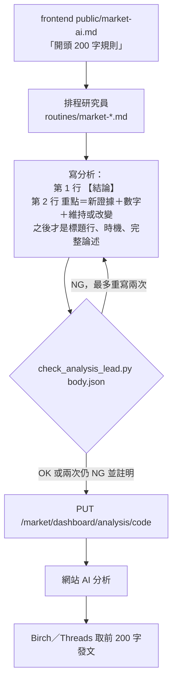

# AI 分析的前 200 字：新證據與買賣建議，不是股價

2026-11-03：每份 AI 分析的前 200 字會被單獨拿去發 Threads（只收 200 字）。實際檢查當天五份分析（台積電 2330、聯亞 3081、
Advantest 6857-JP、LITE-US、META-US），前 200 字幾乎都是「資料截點／研究期間／敘事主軸」的標題，接著才是時機與股價
（LITE：「10/22 單日 -11.5%，低於 MA20，RSI 33.8」）。沒有任何一份在前 200 字講「哪份報告、財報或總經數字帶來什麼新 insight，
所以維持或改變建議」。規則與檢查工具如下。

## 規則（寫在 `ty-multiverse-frontend/public/market-ai.md`，排程每次都讀）

1. 第一行只放 `【結論】買／中立／賣`，可括號寫「維持」或「由 X 改為 Y」。
2. 第二行（重點）必須有新證據（報告、財報、法說、月營收、CPI／PMI／利率等）、數字（附期間）、決定（維持或改變）。
3. 前 200 字不得先講股價漲跌、收盤價、均線、RSI、成交量、支撐壓力、籌碼、融資借券，也不得以資料截點標題開頭；產品價格上漲、營收創新高屬證據可寫。
4. 沒有新證據就直說，並寫下一個證據與公布日，不用股價填。
5. 總經評論沒有結論行，但前 200 字同樣先寫新公布的總經數字與影響。

## 檢查工具：`maya_sawa/public_scripts/check_analysis_lead.py`

標準函式庫、可在排程環境直接跑：`python3 maya_sawa/public_scripts/check_analysis_lead.py body.json [--kind stock|macro]`。
讀存檔 body 的 `content`，只檢查前 200 字裡「評論行之後的第一段」（重點行）：標題字眼、股價與技術用語、新證據用語、數字、
維持／改變用語；印 `OK`（exit 0）或 `NG` 與每項問題（exit 1），讀不到檔 exit 2。四個市場排程（`routines/market-*.md`）要求在 PUT 之前跑它，
NG 就重寫開頭，最多兩次。這是詞表檢查，抓得到「標題或股價在前」，抓不到「內容寫得空洞但詞都有」；內容品質仍靠規則與審閱。

## 開發方法

1. 先量問題：抓五份真實分析的前 420 字存成 `tests/fixtures/analysis_openings_2026-11-03.json`（公開資料），逐份看開頭實際長怎樣。
2. 先寫測試再寫工具：五份真實開頭都必須不通過（原因是標題在前或股價在前）；三種合格寫法（維持、改變、沒新證據）必須通過；
   200 字邊界；產品價格上漲／營收創新高不能被誤判成股價；股價用語在 200 字之後不管；總經評論另一套；CLI 的輸出與 exit code。
   先確認紅（腳本不存在），實作後綠。第一版把「資料截點」放在重點之後也擋掉，測試抓出來，改成只檢查重點行。
3. 規則寫進 `market-ai.md`（單一來源），四個排程的指示檔只寫「存檔前跑檢查」，不複製規則全文。
4. 這次不重寫既有分析；下一次各標的更新時就會套用新開頭。前端 `public/market-ai.md` 在 `dev` 分支，推送後 Jenkins 部署，排程 clone 的就是 `dev`。
5. 下次要換發文長度或欄位：改 `LIMIT`、規則文字與測試，三處一起改。

測試：`poetry run python -m pytest tests/test_analysis_lead.py tests/test_routine_prompts.py -q`（23 個通過）。
已知缺口：檢查是詞表；尚未看過排程用新規則寫出的真實分析（要等下一輪排程，週二 07:30 美股／總經最早）；
網站首頁「研究提示」若另有一份複本不在 `market-ai.md` 裡，我沒有找到、沒有改；Birch／Threads 實際取前 200 字的程式不在這個 repo，沒有驗證。
