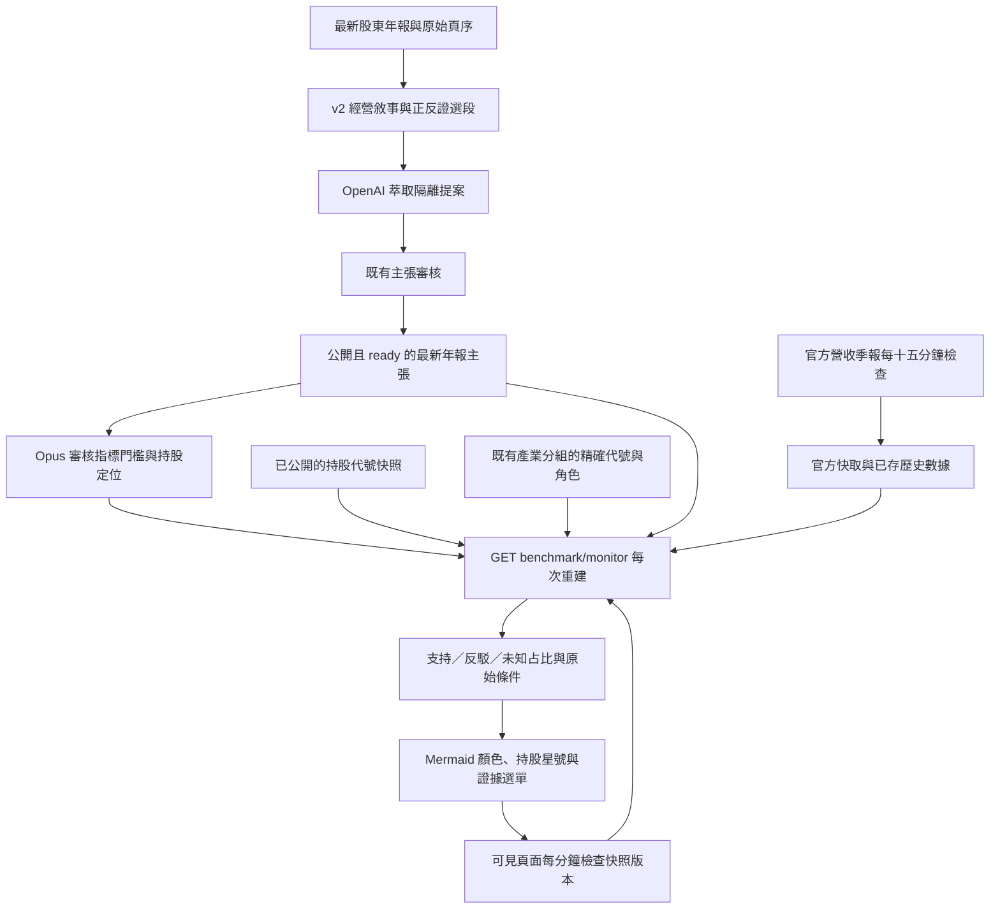

# Benchmark 年報風向、持股定位與數據驗證

## 方法與範圍

年報是可受質疑的管理階層主張，不是產業強弱的客觀答案。分開呈現三層：最新股東年報已審核的方向、已審核驗證條件與最新數據的符合程度、目前持股的位置。圖中不再重複顯示整張公司比較表。綠／紅／黃／藍／灰分別表示年報順風／逆風／多空並存／中性／未知；金框星號表示持股。研究定位的虛線明確標為非供貨關係。明確審核的定位優先，否則沿用既有產業分組中該市場代號的角色，並與同組 benchmark 連研究定位線，來源標為既有分組、非供貨證據。兩者都沒有才獨立顯示「尚未定位」，不按股票名稱猜測。

參考原件：[台積電 2025 股東年報](https://investor.tsmc.com/static/annualReports/2025/english/index.html)、[NVIDIA FY2026 年報](https://www.sec.gov/Archives/edgar/data/1045810/000104581026000021/nvda-20260125.htm)、[IFRS Management Commentary](https://www.ifrs.org/issued-standards/list-of-standards/management-commentary-practice-statement-1/)。台積電的需求、技術與擴產敘述，以及 NVIDIA 的供應承諾、轉代與限制風險，說明必須分清「需求成長」與「能否交付」；這是本系統的方法選擇，並非 IFRS 規定的計分法。

## 年報怎麼讀

1. 只用每家公司最新股東年報，保留原始 PDF 雜湊、會計年度、來源與實際 PDF 頁序；不能將 2025 會計年度誤稱 2026 的實績。
2. 分需求訂單、供應產能、技術量產、交付驗證、限制反證五類找證據。歷史數字與經營敘事混在一句時保留完整句子與比較期間，不因提到營收或毛利就整句排除。
3. 保留產品、地域、年度與原文限定語，區分實績、公司計畫、分析推論。擴產計畫不等於已投產；需求強但交付受限可同時出現，顯示多空並存，不強行平均為中性。
4. 正負面均讀，包含出口限制、訂單取消、庫存調整。最多八項摘要不能視為全書無遺漏；16,000 字的摘錄上限、文字層與關鍵字選段仍有覆蓋限制。圖片、OCR、跨頁表格及未選到的章節不得憑記憶補。
5. 模型主張先進隔離提案，逐字引文必須在該 PDF 頁找到，通過既有審核才可上圖。v2 萃取升版會重新排入最新年報，不覆寫舊主張；新版未通過前保留同一 PDF 的舊版已審核主張。不同 PDF 的舊主張不能沿用。

## 百分比的定義

每個 benchmark 有最多二十個已審核條件：指定標的、指標、方向、門檻、有效期與權重，以及它檢驗的年度格局主軸 `theme`（T1～T9）和與 benchmark 的關係 `relation`（customer、supplier 或 self）。年度格局是唯一的敘事來源，monitor 只負責計分。兩條以上條件不可全是 self：公司自己的營收大多只是重述自己年報的樂觀，必須沿 benchmark links 找客戶或供應商交叉驗證。相同標的與指標只能有一項，以免重複計數。初始建議等權重一；改權重必須有審核理由，不能由語氣或新聞數量決定。

- 支持占比 = 符合條件權重 / 全部條件權重 × 100。
- 反駁占比（API `headwindPercent`）= 不符合條件權重 / 全部條件權重 × 100。
- 未知占比 = 缺值、非有限值、未來期別、缺來源或過期權重 / 全部條件權重 × 100。
- 條件少於三條或沒設定條件時，三項百分比為 null，只公布 `counts`（支持、反駁、未知與總條數）。這不是報酬率、產業衰退幅度或預測機率。
- 指標白名單：月營收年增率、季營收年增率、毛利率、毛利率年變動 pp、營業利益率。月年增與月增不混用，毛利率水準與變動 pp 分開。
- 門檻若不是年報揭露，必須寫明是研究者選用的代理驗證門檻、基準與限制，不能聲稱年報說了該百分比。總營收或總毛利不能直接驗證特定 AI 產品的需求與良率；無直接數據就留缺口。
- 海外季度數據讀既有已存 SEC／日本／韓國財報，按市場後綴分開，再轉接營收年增與毛利等指標；沒有可識別來源或過期時保留未知，不能拿台灣同碼股票的數據代替。海外不假造月營收。

例：四個等權條件中，兩個符合、一個不符、一個未知，顯示支持 50%、反駁 25%、未知 25%，不是「產業有 25% 逆風」。正式條件只能引用最新年報已審核的 reportId、page、逐字 evidence，換版後不符的條件會失效。

## 架構圖



持股變更後，下次讀 monitor 就用最新名單，不等待年度格局七天更新；頁面開啟時每分鐘檢查。這版採讀取時重建，沒有宣稱伺服器在每筆持股入庫時保存歷史圖。只讀代號、名稱與市場，不發出張數、成本、損益與金額。已關閉頁面不輪詢，導覽時清除計時器。

## API 與憑證

`GET /market/benchmark/monitor` 公開回傳 nodes（年報方向、原文與逐條驗證）、holdings、holdingsSnapshotAt、revision。revision 為持股與證據內容的雜湊；資料未變不重畫。新表在既有 benchmark sync 初始化建立；尚未初始化回 503，頁面顯示不可用而不造數據。

`PUT /market/benchmark/monitor/{benchmarkCode}` 沿用 Claude network secret 的 `X-Market-Agent-Key` 與既有驗證。key 不讀取或輸出；PostgreSQL 沿用 market engine。body：

```json
{
  "code": "2330",
  "checks": [{
    "code": "3037", "metric": "monthly.yoyPercent", "operator": "gte",
    "threshold": 60, "maxAgeDays": 60, "weight": 1,
    "reportId": "必須使用GET回傳的真實ID", "page": 12,
    "evidence": "必須使用GET回傳的同頁逐字引文",
    "rationale": "僅為schema範例，60並非已核實的年報門檻；正式使用須交代基準、傳導與代理限制",
    "theme": "T1", "relation": "customer"
  }],
  "holdings": [{"code": "3037", "role": "載板，與先進封裝需求相關", "evidence": "填入已核對的產品與業務定位依據"}],
  "reviewNote": "逐項核對原文、比較期、單位、門檻理由與定位關係",
  "expectedRevision": 0
}
```

不能照抄範例數字當正式設定。海外 code 使用 NVDA-US、6857-JP，台灣使用 2330。更新 PUT 是整份替換，必須先 GET 並保留其他已審核條件與定位。`expectedRevision` 要帶 GET 回來的 `configuration.revision`，不符回 409，以免覆寫別人剛存的版本。仍沒有歷史版本審核介面，例程應由美股總經 Opus 負責統一維護。台股班只提議定位，避免併發覆寫。

## 開發方法

1. 2026-11-12：先重現混合營收與擴產敘述被排除，以及出口限制未入選；再修選段與 profile 重排。仍走原有隔離審核，不直接把模型輸出當強弱。
2. 先測缺值、零、NaN、未來與過期資料、月季期別、百分比與 pp、重複計數、同碼不同市場、持股更新與敏感金額排除，再做純計分與 read-through monitor。
3. 先測持股星號、未知與多空並存、每分鐘快照更新及導覽清理，再加入 Mermaid 註記、證據選單並移除重複公司表。瀏覽器故障保留前次圖且明示過期，不靜默當最新。
4. 官方全市場 feeds 原本每小時檢查，調至十五分鐘，仍共用快取與並發鎖；不增加 FinMind 付費抓取，不把檢查頻率說成資料發布頻率。
5. 上線順序：後端 schema 與 read-only monitor → 確認未知基準與權限 → 前端圖與持股 → 已審核門檻逐筆加入 → 核對實際期間與計算。不得為了上色而補不存在的數據。
6. 正式環境唯讀盤點：23 家最新年報已入庫，31 份年報摘錄仍為 claims_pending；日月光最新年報為 quarantined。單次既有設定的 OpenAI 診斷回 429，code=credit_balance_exhausted、type=insufficient_quota，確定 API 餘額不足。程式遇此錯誤停止本輪而不對二十四份連續重試；未修改帳務。補足餘額或既有 GPT 提案審核完成後，才有足夠主張校準規則。

7. 2026-11-12 審查後補強：
   - 年報主張萃取改由美股總經 Opus 班（routine 第 1.4 節）用訂閱額度做，帶 agent key 送進同一個提案箱，不受匿名每週 100 筆上限限制，仍由 Sonnet 審核。
   - 條件必須標 `theme` 與 `relation`，兩條以上不可全是 self。
   - 少於三條條件時只公布條數。
   - PUT 加入 `expectedRevision`。

8. 2026-11-12 第二輪（使用者指示）：
   - 目的重申：龍頭年報定敘事，持股用自己的財報與高頻數據判斷超前或落後。
   - 新增 `holdings[].pace`：與對照龍頭同期月營收（無則季營收）年增率相差 ≥10pp 為超前、≤−10pp 為落後，其餘同步；期別不同或缺值為資料不足。由 `benchmark_strength.pace_verdict` 計算，`attach_pace` 補抓持股與龍頭的觀測值。
   - 8996 高力依使用者指定對照 2308 台達電（rule holdings，正式資料庫直接寫入 revision 1）。
   - PUT 若漏掉既有 holdings 對照回 422，避免排程整份替換時誤刪。
   - 前端：無證據的節點不再加「待審／缺資料」字樣；未定位持股不畫，改列在圖下；顯示主張覆蓋數。
   - 操作規則整併成 skill：`.claude/skills/benchmark-monitor/SKILL.md`，routine 第 1.4、8.5 節改為引用它。

## 測試與限制

`poetry run python -m pytest tests/market/test_benchmark_strength.py tests/market/test_benchmark_monitor_api.py tests/market/test_market_fundamentals.py tests/integrations/test_benchmark_analysis.py tests/integrations/test_benchmark_evidence.py -q`

前端：`vitest run tests/market/benchmarkMonitor.test.ts tests/market/benchmarkChain.test.ts tests/market/benchmarkDiagram.test.ts tests/market/benchmarkReports.test.ts`。

本版不是完成所有年報的人工研究，也未校準出產業衰退百分比。未知與待審清楚可見。尚需直接產品指標、門檻歷史與回測，以及完整年報／OCR 覆蓋審查；不能將目前的代理證據占比解讀成統計預測能力。
