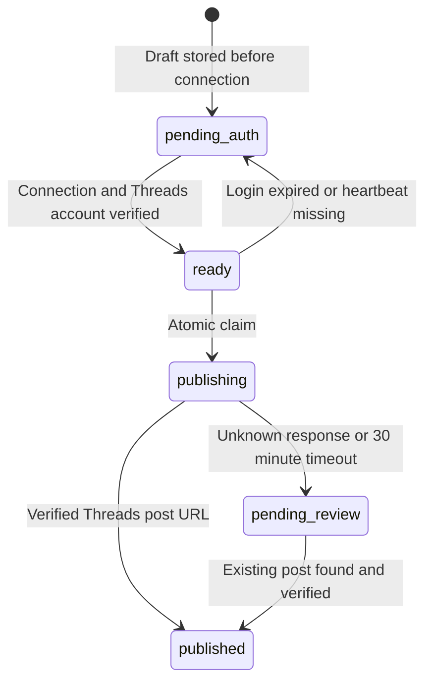

# Birch Investments publishing and login recovery

Prepared 2026-10-29 for Threads account `birch_investments`. The ChatGPT Work task is cloud-based, hourly,
Asia/Taipei, and paused pending publisher connections. It reads public macro/stock analyses; it does not publish
private reports, holdings quantities, costs or account values. Metricool is the posting tool; Maya Sawa owns the
durable outbox and sends owner-only attention notifications through the existing Telegram bot.

## Durable state

`maya_sawa_publish_job` stores the source identity `productType:code:revision`, draft, state, attempt count, and verified
published URL. The source identity is a primary key: retries keep the original draft and cannot create a second job.
`maya_sawa_publisher_account` stores authorization readiness, the latest scheduler heartbeat, and notice deduplication.

Only `ready` can be claimed. Resuming authorization releases `pending_auth`, but never `pending_review` or published
items. An ambiguous publication must be checked against Threads/Metricool; no automatic resend is allowed. Current
MVP intentionally requires manual reconciliation if the platform cannot establish whether the post exists.

The 15-minute backend monitor sends one attention message per unresolved episode. Telegram delivery failure leaves
the episode eligible for retry. A task must send a heartbeat on every run, including no-content runs. Once heartbeats
have started, three hours without a heartbeat moves ready jobs to `pending_auth` and alerts the owner to check the
ChatGPT/Metricool connection. This catches expiry of the Maya connector itself; it cannot notify instantaneously when
that connector is unavailable. Initial setup without a heartbeat does not start a false stale-task alarm.

## Protected cloud tools

MCP URL currently registered in ChatGPT: `https://peoplesystem.tatdvsonorth.com/maya-sawa/market/publishing/mcp`

Discovery: `https://peoplesystem.tatdvsonorth.com/maya-sawa/market/publishing/.well-known/oauth-protected-resource`

The stateless Streamable HTTP endpoint uses the site's existing Keycloak issuer. Every tool request requires a valid,
unexpired user token with the **exact MCP URL as audience**, scope `birch.publish`, and the site's existing owner role.
These tokens do not authorize general Maya API routes. No Telegram token, chat ID, generic API write key, arbitrary
notification recipient, arbitrary URL fetch, or social credential is exposed by this connector.

Tools: `birch_sources`, `birch_status`, `birch_enqueue_draft`, `birch_auth_required`, `birch_resume`, `birch_claim`,
`birch_published`, `birch_pending_review`, `birch_heartbeat`.

Scheduled flow:

1. Call `birch_heartbeat`, then `birch_status`, then `birch_sources` (with `since` = last successful check) to read
   current public source revisions and the saved outbox. `birch_sources` is read-only and returns only what the public
   `/dashboard/analysis/{code}` routes already serve (current `stock` analyses and `macro:US`), newest first, at most 30,
   each with its job id. It exists because ChatGPT's web reader could not fetch the dashboard JSON on 2026-11-01.
2. Verify Metricool's connection and exact Threads account before resuming. If it needs login, call
   `birch_auth_required` with a fixed reason and stop publishing; drafts remain stored.
3. Enqueue a draft for the current public source revision. If already stored, use the existing job.
4. Call `birch_claim`; only `claimed=true` authorizes this run to make the external post.
5. Publish through Metricool, then call `birch_published` with the verified live post URL.
6. For an unknown result, call `birch_pending_review`, reconcile the platform, and never blindly retry.

## Connection still requires approval

The endpoint is locked until a dedicated OAuth client and user connection are configured. Do not turn off
authentication to make setup easier. Prepare a dedicated Keycloak authorization-code client with PKCE S256,
no direct-password grant, no service account, and only this resource audience and `birch.publish` scope.
Use the **exact callback URI displayed by ChatGPT's custom MCP setup**; do not register a wildcard or guess it.
Scope mappings must expose the existing owner role only to users who already have it; never grant a new admin role.
Keep any client secret in Keycloak/ChatGPT's connection store, never in a task prompt or Git.

After user approval, connect this MCP server and Metricool in the same ChatGPT Work task, verify both tool sets,
test one draft/recovery run, and only then enable the paused hourly task. Until that is verified, do not claim that
the cloud task can automatically notify Telegram or publish. Chrome login alone is not a cloud connector.

References: [ChatGPT custom MCP](https://developers.openai.com/api/docs/guides/custom-mcp-server),
[OAuth requirements](https://developers.openai.com/plugins/build/auth),
[Streamable HTTP](https://modelcontextprotocol.io/specification/2025-11-25/basic/transports),
[Metricool connection](https://help.metricool.com/how-to-connect-metricools-mcp-with-chatgpt-0lrl3).

## Verification

`poetry run python -m pytest tests/test_social_publish_queue.py tests/test_publisher_auth.py tests/test_publisher_mcp.py tests/test_market_notifications.py tests/test_telegram_notify.py tests/test_public_api.py -q`

Full suite on 2026-10-29: 689 passed, 18 skipped, 5 existing failures (Redis/connection utility tests and missing
industry membership for 009811). Resource-token isolation, owner scope, denied unauthenticated requests, persistence,
claim deduplication, notification retries, heartbeat loss, and ambiguous publication recovery are covered by tests.

## Channel order update (2026-10-30)

The existing ChatGPT Work task remains paused and is scheduled weekly on Wednesday, Friday and Sunday at night (Asia/Taipei). Its prompt now treats publication channels independently: after Threads authorization, exact account verification and a successful Threads outbox claim, Threads may publish without waiting for LinkedIn. Save LinkedIn drafts as pending until LinkedIn authorization and per-channel publisher/outbox tools exist; when ready, publish only the pending LinkedIn version and never repost a successful Threads item. This records the requested task behavior; it does not mean either social connection is currently authorized or that a post was sent.

## Investigation and design record (2026-11-01)

- The `birch_investments` profile showed its newest visible posts dated 2026-10-29 when inspected. This establishes the observed gap, not why a particular run did or did not publish.
- The records above conflict with `ty-multiverse-frontend/docs/THREADS_LINKEDIN_AUTOMATION.md`, which says the task was active. They are historical notes, not proof of the current schedule, connector grants, execution history, or deployment. The ChatGPT Scheduled page remained at “loading profile” during this investigation; the task and its run history could not be inspected or modified. Verify the task's current state, time zone, last expected run and its result before assigning a cause.
- The deployed state and current Metricool and Maya connector authorizations were not verified. Do not claim that the task has been repaired, that Telegram delivery is configured for each run, or that a missing post was sent.
- The repository's monitor only sends an attention notification for an unresolved authorization, stale heartbeat, or ambiguous publishing episode. `birch_published` and `birch_heartbeat` do not send a per-run result, and a task that never sends its first heartbeat cannot trigger the stale-heartbeat alert. Thus it does not satisfy the requested notification for every published, skipped, or failed scheduled run.
- There is a schedule mismatch: `check_stalled` treats a heartbeat older than three hours as missing, while the later schedule above says Wednesday, Friday and Sunday. If that weekly schedule is current and the monitor is deployed, it will report a healthy task as stale between runs. Do not simply enable it with the existing threshold. Track expected run slots in Asia/Taipei and a grace period instead; do not infer a missed run from an hourly heartbeat threshold. Alert once per missed slot and distinguish intentionally paused schedules. The schedule and monitor must use the same authoritative configuration.

### Required per-run contract

Each expected slot needs a durable run ID and one terminal result: `published` (verified URL), `skipped` (specific reason, such as no material new source), `blocked` (connection or authorization), `failed` (step and safe error summary), or `unknown` (publication outcome needs reconciliation). Record scheduled and completion times, source revision, channel, and notification delivery status without credentials or private portfolio data. A successful Threads post must not depend on LinkedIn readiness. Do not blindly retry an unknown external publication.

On each terminal result, deliver one concise Telegram message to the existing owner destination, including the slot, result, reason or verified URL, and next action. Retry failed Telegram delivery independently with an idempotency key per run; do not repeat publishing to retry a notification. An independent watchdog must report a missed expected slot even when the worker never starts. This requires a separate reliable scheduler and notification path: a prompt's final step cannot run after a crash, paused task, or loss of its connector. Monitor the watchdog and notification delivery as well. Until implemented, deployed, connected, and exercised with success, skip, failure, missed-run and Telegram-delivery-failure cases, this is a requirement rather than an operational guarantee.

### Work coordination assessment

The existing durable outbox, atomic claim, source revision and `pending_review` state are useful shared coordination primitives. The cloud task currently combines research, drafting, connector checks and publication, and its documentation lacks a single verified operational status. A long-lived coordinating AI would add context and handoff cost without solving these availability gaps.

Use Git and issues for development coordination: a bounded issue should carry the user feedback, evidence and links, scope, acceptance criteria, constraints, dependencies, and the current commit or artifact version. Independent sessions claim non-overlapping issues, work on branches, and communicate through reviewed changes and issue updates. Keep a short checkpoint and measured token usage per session; 400k tokens is an initial budget to evaluate, not a universal optimum. Context packages should be task-specific; skills may still encode reusable safety or workflow rules. Git and issues coordinate engineering work, while the runtime database and atomic claims remain the source of truth for publishing and preventing duplicates. Concurrency requires explicit ownership, conflict handling, and review; PR count alone does not measure quality or cost.

Next steps: inspect the actual scheduled task and latest execution; verify both connections and deployment without exposing credentials; align schedule and watchdog; implement the run result and notification contract; verify end-to-end before claiming unattended operation. Update the contradictory frontend document with the verified current state when available.

### Live investigation, 2026-11-01 13:05 Asia/Taipei

- ChatGPT Scheduled showed `Birch Investments｜研究更新` **enabled**, with the next run approximately nine hours away. The current instructions specify Wednesday, Friday and Sunday nights in Asia/Taipei and use Threads only; older task-conversation messages describing a paused, dual-channel task are historical. The shown next run is consistent with 22:00 on Sunday, but this observation alone does not establish previous execution outcomes.
- ChatGPT plugin settings marked Birch Publishing **reconnect**; its registered URL and OAuth resource use the old domain. The new-domain discovery endpoint currently returns the old-domain resource, and the infrastructure migration notes explicitly retain that audience until Keycloak and the connector are migrated together. The initial suspicion that the old domain alone was a defect was not established. A reconnect was initiated and reached the PeopleSystem sign-in page; completion requires the owner to sign in.
- A search of installed ChatGPT plugins for `Metricool` returned no match. The scheduled instructions require both Birch Publishing and Metricool and explicitly stop when either is unavailable. Consequently the current setup cannot be assumed capable of posting; the exact outcome of the last scheduled run is still unverified.
- Read-only inspection of the live Maya deployment showed one outbox item, `macro:US:8`, marked published on 2026-10-29 with its Threads URL; the account's stored heartbeat was empty. The publicly visible 10/29 stock post was not present in the returned outbox. This does not establish its source revision or how it was published. Reconcile existing posts against source revisions before backfilling or trusting the outbox to prevent duplicates.
- The existing three-hour heartbeat logic cannot detect a task that never connected, and would be inappropriate for the observed multi-day schedule. No per-run Telegram delivery or watchdog fix has yet been deployed. Reconnecting alone does not implement either requirement.

## Resource URL moved to tymultiverse.cc (2026-11-01)

`RESOURCE` in `maya_sawa/api/publisher_mcp.py` (advertised in protected-resource metadata and required as the token
audience) is now `https://tymultiverse.cc/maya-sawa/market/publishing/mcp`, matching the connector URL above. The old
`peoplesystem.tatdvsonorth.com` value made ChatGPT's OAuth setup fail on a resource mismatch. Keycloak realm
`PeopleSystem` already had public client `birch-publisher-chatgpt` (standard flow only, PKCE S256, one exact
`https://chatgpt.com/connector/oauth/...` redirect, web origin `https://chatgpt.com`) with default client scope
`birch.publish`; that scope's Audience mapper was moved to the new URL the same day. The client still has
"Full scope allowed" on, so tokens carry all of the user's roles; the API only accepts them for this audience.
Covered by `test_resource_metadata_matches_public_connector_url`.
