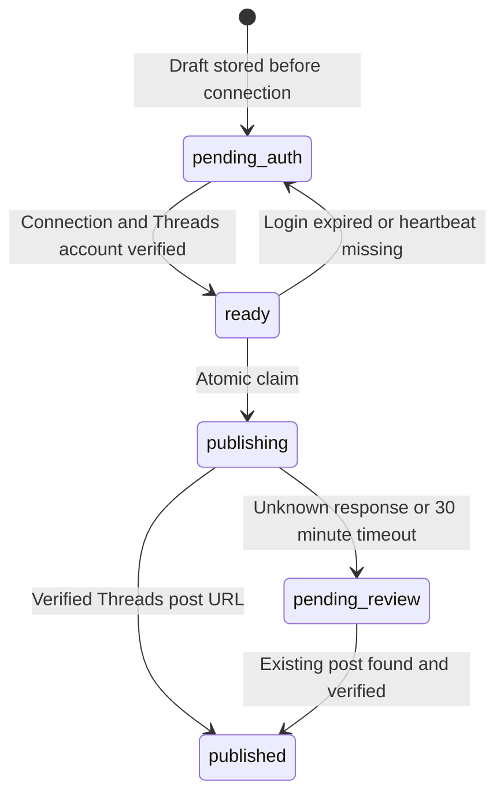

# Birch Investments publishing and login recovery

Prepared 2026-10-29 for Threads account `birch_investments`. The ChatGPT Work task is cloud-based, hourly,
Asia/Taipei, and paused pending publisher connections. It reads public macro/stock analyses; it does not publish
private reports, holdings quantities, costs or account values. Metricool is the posting tool; Maya Sawa owns the
durable outbox and sends owner-only attention notifications through the existing Telegram bot.

## Durable state

`maya_sawa_publish_job` stores the source identity `productType:code:revision`, draft, state, attempt count, and verified
published URL. The source identity is a primary key: retries keep the original draft and cannot create a second job.
`maya_sawa_publisher_account` stores authorization readiness, the latest scheduler heartbeat, and notice deduplication.

Only `ready` can be claimed. Resuming authorization releases `pending_auth`, but never `pending_review` or published
items. An ambiguous publication must be checked against Threads/Metricool; no automatic resend is allowed. Current
MVP intentionally requires manual reconciliation if the platform cannot establish whether the post exists.

The 15-minute backend monitor sends one attention message per unresolved episode. Telegram delivery failure leaves
the episode eligible for retry. A task must send a heartbeat on every run, including no-content runs. Once heartbeats
have started, three hours without a heartbeat moves ready jobs to `pending_auth` and alerts the owner to check the
ChatGPT/Metricool connection. This catches expiry of the Maya connector itself; it cannot notify instantaneously when
that connector is unavailable. Initial setup without a heartbeat does not start a false stale-task alarm.

## Protected cloud tools

MCP URL: `https://peoplesystem.tatdvsonorth.com/maya-sawa/market/publishing/mcp`

Discovery: `https://peoplesystem.tatdvsonorth.com/maya-sawa/market/publishing/.well-known/oauth-protected-resource`

The stateless Streamable HTTP endpoint uses the site's existing Keycloak issuer. Every tool request requires a valid,
unexpired user token with the **exact MCP URL as audience**, scope `birch.publish`, and the site's existing owner role.
These tokens do not authorize general Maya API routes. No Telegram token, chat ID, generic API write key, arbitrary
notification recipient, arbitrary URL fetch, or social credential is exposed by this connector.

Tools: `birch_status`, `birch_enqueue_draft`, `birch_auth_required`, `birch_resume`, `birch_claim`,
`birch_published`, `birch_pending_review`, `birch_heartbeat`.

Scheduled flow:

1. Call `birch_heartbeat`, then `birch_status`. Read current public source revisions and the saved outbox.
2. Verify Metricool's connection and exact Threads account before resuming. If it needs login, call
   `birch_auth_required` with a fixed reason and stop publishing; drafts remain stored.
3. Enqueue a draft for the current public source revision. If already stored, use the existing job.
4. Call `birch_claim`; only `claimed=true` authorizes this run to make the external post.
5. Publish through Metricool, then call `birch_published` with the verified live post URL.
6. For an unknown result, call `birch_pending_review`, reconcile the platform, and never blindly retry.

## Connection still requires approval

The endpoint is locked until a dedicated OAuth client and user connection are configured. Do not turn off
authentication to make setup easier. Prepare a dedicated Keycloak authorization-code client with PKCE S256,
no direct-password grant, no service account, and only this resource audience and `birch.publish` scope.
Use the **exact callback URI displayed by ChatGPT's custom MCP setup**; do not register a wildcard or guess it.
Scope mappings must expose the existing owner role only to users who already have it; never grant a new admin role.
Keep any client secret in Keycloak/ChatGPT's connection store, never in a task prompt or Git.

After user approval, connect this MCP server and Metricool in the same ChatGPT Work task, verify both tool sets,
test one draft/recovery run, and only then enable the paused hourly task. Until that is verified, do not claim that
the cloud task can automatically notify Telegram or publish. Chrome login alone is not a cloud connector.

References: [ChatGPT custom MCP](https://developers.openai.com/api/docs/guides/custom-mcp-server),
[OAuth requirements](https://developers.openai.com/plugins/build/auth),
[Streamable HTTP](https://modelcontextprotocol.io/specification/2025-11-25/basic/transports),
[Metricool connection](https://help.metricool.com/how-to-connect-metricools-mcp-with-chatgpt-0lrl3).

## Verification

`poetry run python -m pytest tests/test_social_publish_queue.py tests/test_publisher_auth.py tests/test_publisher_mcp.py tests/test_market_notifications.py tests/test_telegram_notify.py tests/test_public_api.py -q`

Full suite on 2026-10-29: 689 passed, 18 skipped, 5 existing failures (Redis/connection utility tests and missing
industry membership for 009811). Resource-token isolation, owner scope, denied unauthenticated requests, persistence,
claim deduplication, notification retries, heartbeat loss, and ambiguous publication recovery are covered by tests.
