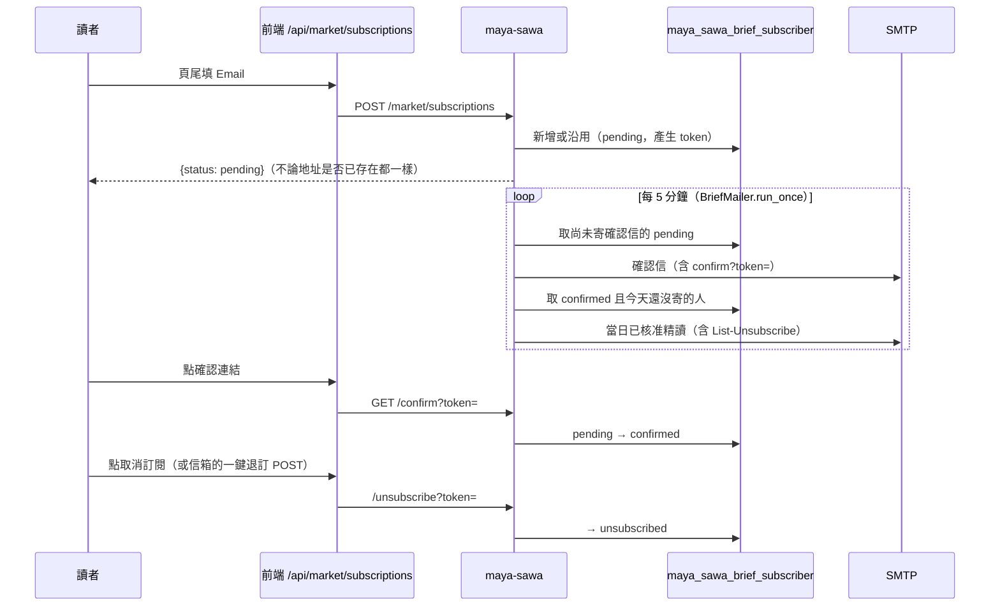

# 每日精讀 Email 訂閱（2026-11-10）

網站頁尾可以填 Email 訂閱。確認後，每天當日精讀核准時會收到一封純文字信：標題、日期、精讀全文、收聽與追蹤連結、免責聲明、取消訂閱連結。

**目前狀態：程式已上線，寄信尚未啟用。** 沒有 SMTP 憑證時，訂閱申請照常存進資料庫（狀態 `pending`），不會寄任何信；憑證設定好之後，尚未寄出的確認信會自動補寄。

## 規則

- **雙重確認。** 沒點確認連結的地址永遠不會收到每日信；每個地址只寄一次確認信。
- **一人一天一封。** 寄送前先在資料庫把該訂閱者的 `last_sent_day` 改成當天（條件式 UPDATE，多個 Pod 也只有一個成功）；寄失敗就還原，下一輪重試。
- **只寄「今天（台北日期）已核准」的精讀**，和語音同一個來源；當天沒有核准稿就不寄。
- **每封信都有取消訂閱**：內文連結，加上 `List-Unsubscribe` 與 `List-Unsubscribe-Post`（RFC 8058 一鍵退訂）。
- **防濫用**：Email 格式驗證（拒絕換行，防標頭注入）；24 小時內新申請上限 200 筆（每筆會花一封確認信）；每輪最多寄 100 封，其餘下一輪。
- **隱私**：API 不回傳也不列出任何地址或 token；日誌只記數量與例外類別。token 只出現在寄給本人的信裡。
- 信裡的追蹤連結來自 `config/connect-links.json`，要和前端 `src/scripts/socialLinks.ts` 同步。

## 啟用寄信（需要使用者本人操作）

寄信走標準 SMTP（STARTTLS、587）。建議用 OCI Email Delivery，因為網域已在 OCI：

1. OCI Console → Email Delivery：為 `tymultiverse.cc` 建立 Email Domain、加 DKIM，並把 DKIM 與 SPF 紀錄加到 Porkbun DNS；建立 Approved Sender（例如 `brief@tymultiverse.cc`）。
2. 為一個 OCI 使用者產生 SMTP Credentials（帳號與密碼只顯示一次）。
3. 在 Jenkins 建四個 Secret text 憑證：`BRIEF_MAIL_SMTP_HOST`（例如該區域的 `smtp.email.<region>.oci.oraclecloud.com`）、`BRIEF_MAIL_SMTP_USERNAME`、`BRIEF_MAIL_SMTP_PASSWORD`、`BRIEF_MAIL_FROM`（`Birch Investments <brief@tymultiverse.cc>`）。
4. 重新部署 maya-sawa。`Configure Brief Mail` 階段會建立 K8s Secret `brief-mail-credentials`；缺憑證時該階段標成 UNSTABLE 但不擋部署。

憑證不寫進原始碼、文件、指令參數或對話。

## 開發方法

1. 先寫失敗測試 `tests/market/test_brief_subscriptions.py`：未確認不寄、確認信只寄一次、未設定 SMTP 完全不寄、每日信一人一天一封且失敗會重試、信件內容含全文／連結／退訂、API 不洩漏地址是否存在、每日申請上限。
2. 實作：`databases/brief_subscribers_db.py`（資料表與原子認領）、`services/brief_mailer.py`（信件內容與寄送迴圈）、`api/brief_subscriptions.py`（公開端點）；在 `main.py` 啟動每 5 分鐘的迴圈。
3. 部署：`k8s/deployment.yaml` 以 `optional: true` 的 SecretKeyRef 注入四個環境變數；`Jenkinsfile` 的 `Configure Brief Mail` 階段。
4. 前端：頁尾表單 `src/scripts/footer/subscribe.ts`，代理 `src/pages/api/market/subscriptions/`（`[action].ts` 把確認／退訂結果顯示成簡單頁面）。

## 仍未做

- 寄信尚未實測（沒有 SMTP 憑證）。啟用後先用自己的地址訂閱一次，確認三封信（確認、每日、退訂後不再寄）。
- 沒有退信（bounce）處理；名單變大前要接 OCI 的 suppression list 或退信通知。
- 隱私權政策頁還沒寫到 Email 訂閱的資料用途。
