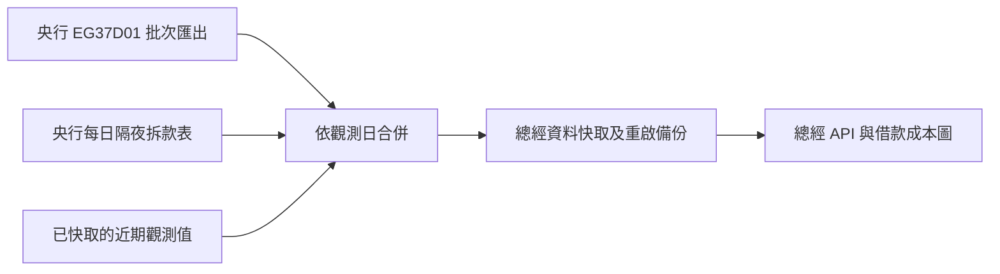

# 央行隔夜拆款利率

現有總經收集器每 12 小時刷新借款利率。央行批次匯出與每日公告的更新頻率不同，兩者以觀測日合併。

## 開發方法

1. 2026-11-17 核對批次 API 截至 09-30，官網日表已到 11-16。先擴充借款利率回歸測試，重現缺少近期資料。
2. 批次匯出保留歷史，每日表由新到舊最多讀三頁，碰到批次日期即停止。略過缺值，按日期去重。日表暫時讀取失敗時保留已快取的近期觀測值。
3. 兩個來源都公開，無須新增憑證。執行 `poetry run python -m pytest tests/market/macro/test_market_macro_borrowing_rates.py -q`。部署後待既有排程刷新，核對 `/api/market/dashboard/macro?historyMonths=60` 的 `TW_INTERBANK_OVERNIGHT` 最新觀測日。
