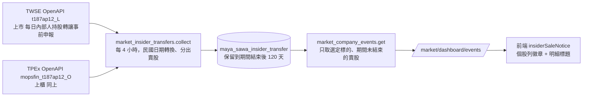
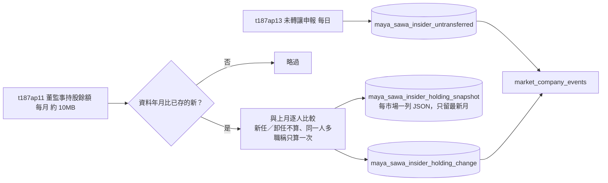

# 內部人申報賣股（2026-11-17）

個股若有董事、監察人、經理人或大股東申報「持股轉讓事前申報」且有效轉讓期間還沒結束，就在個股列（含持股清單）與個股明細標題旁標「內部人申報賣股中」；有效期間 7 天內才開始的標「內部人即將賣股」。滑過去看申報人、預定股數、轉讓方式與期間。這筆也會出現在「近期公司事件」表。

## 規則

- **只把賣到市場的轉讓算賣股**：一般交易、盤後定價、鉅額、洽特定人、拍賣、標購、公開招募。贈與、信託等不算，不標示（`SALE_METHODS`）。
- 同一檔多人申報合併為一筆事件，股數加總，寫「N 位內部人」。
- 申報是「預定」轉讓上限，不代表已成交；期間結束沒賣完會另有「未轉讓申報」，見下節。

## 限制

- OpenAPI 每次只列**最新一個營業日**的申報，沒有歷史。所以要每天收、存進資料庫。**部署前已申報、期間還沒結束的不會出現**，約一個月後才完整。
- MOPS 的查詢頁對匿名請求回「因安全性考量無法呈現」，不能補歷史（見前端 `docs/MARKET_DASHBOARD_PLAN.md`）。

## 開發方法

用當天真實回應各取 4 筆做 fixture（`tests/fixtures/market/insider_transfer_twse.json`、`insider_transfer_tpex.json`），`tests/market/test_insider_transfers.py` 測民國日期、兩市場欄位差異、賣股分類、期間判斷、多人合併、存取不重複與公司事件整合；前端 `tests/market/companyEventPresentation.test.ts` 測徽章文字。

## 未轉讓申報與內部人增持（2026-11-17 同日加）

| 標記 | 顏色 | 來源 | 規則 |
|---|---|---|---|
| 內部人申報賣股中／即將賣股 | 紅 | `t187ap12_L`、`mopsfin_t187ap12_O`（每日） | 見上 |
| 內部人申報未賣出 | 灰 | `t187ap13_L`、`mopsfin_t187ap13_O`（每日） | 申報日起 14 天內顯示，含未轉讓股數、原申報股數與理由（如「股價不理想」） |
| 內部人增持 | 綠 | `t187ap11_L`、`mopsfin_t187ap11_O`（每月董監事持股餘額） | 與上個月比，只算兩個月都在名單上的人，淨增加 ≥ 10 張；顯示到下個月資料出來 |

增持判斷的取捨：

- **只給最新一個月，沒有歷史**：第一次部署只會存下當月快照，**要等下個月資料公布（約每月中）才有第一批增持標記**。
- 同一人可能以多個職稱出現（例：法人代表人兼總經理），以姓名去重，避免重複加總。
- 所有人持股同比例增加（±0.5%）視為配股，不標記。
- 月持股差額可能含員工認股、繼承等非市場取得，所以標「增持」並在說明寫明，不寫成「買進」。
- 快照存成每市場一列 JSON，不逐人寫入，避免每月數萬列寫進只有 100m CPU 的 postgres。
- 未轉讓申報、持股餘額每天抓一次（排程每 4 小時一輪，每 6 輪做一次）；持股檔同月份會略過比較。

開發方法：fixture 為當天真實回應（`insider_untransferred_*.json`；`insider_holdings_twse.json` 取 1101、2330 兩檔），上月資料由測試在 fixture 上改動產生；測試涵蓋空白列、多職稱去重、新任卸任、配股型態、10 張門檻、同月重跑。

## 爆大量標記（2026-11-17）

Telegram 的「成交量進入近一年前 10／前 5 大」一直只發通知（`intraday_alerts._volume_alerts`），個股列沒有任何標示。現在同一套排名（`volume_rank.week_summary`）也做成公司事件 `volume_spike`，個股列、持股列、明細標題旁會標：

- **爆大量 · 年度前 5**：本週任一天成交量進入近一年（約 250 個交易日）前 5。
- **大量 · 年度前 10**：本週最高只進前 10。
- 滑過去看「週一第 2 名（前 5）、週二（今日）第 7 名（前 10）」這類逐日排名。標記看**本週一到今天**，所以這週報過兩次的股票，整週都會留著，跟 Telegram 的「本週成交量排名」一致。

資料來源與限制：

- 每日量取自資料庫的證交所／櫃買日資料，不足一年時退回 Yahoo（`intraday_alerts.volume_history_for`，每檔每天只讀一次）。歷史少於 120 天的股票不標，與 Telegram 規則相同。
- 今天的量用 Shioaji 即時報價（成交金額 ÷ 均價），**只在報價是今天的才採用**（`live_volumes_from_quotes`），否則今天不算，只看已收盤的日子。盤後若資料庫還沒補今天的日資料，今天會暫時沒有排名，下一輪補齊後出現。
- 排名窗口是「今天以前的近一年」，本週稍早的日子也在窗口內，所以同一週第二次爆量的名次會稍微比第一次低一點，這是原有規則。

### 日股也標爆大量（2026-11-17）

- 一開始只處理了台股；日股（市場 `JP`）的 6857（ADVANTEST）沒被標到，因為事件服務只認 4 位數字代號並當台股，而且台股也有 6857（宜特），兩者會混在一起。
- 現在 `/dashboard/events` 把 `market == JP` 的股票分開處理：`japan_volume_history` 從 Yahoo `.T` 日線取一年成交量（今天之前的日子）與今天的即時量，同樣用 `week_summary` 排名，事件帶 `market: "JP"`。
- 前端事件以 `marketEventKey(code, market)` 當鍵，台股維持 `6857`，日股為 `JP:6857`，所以同碼不會互相標到。
