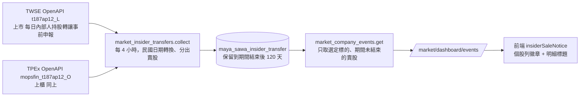

# 內部人申報賣股（2026-11-17）

個股若有董事、監察人、經理人或大股東申報「持股轉讓事前申報」且有效轉讓期間還沒結束，就在個股列（含持股清單）與個股明細標題旁標「內部人申報賣股中」；有效期間 7 天內才開始的標「內部人即將賣股」。滑過去看申報人、預定股數、轉讓方式與期間。這筆也會出現在「近期公司事件」表。

## 規則

- **只把賣到市場的轉讓算賣股**：一般交易、盤後定價、鉅額、洽特定人、拍賣、標購、公開招募。贈與、信託等不算，不標示（`SALE_METHODS`）。
- 同一檔多人申報合併為一筆事件，股數加總，寫「N 位內部人」。
- 申報是「預定」轉讓上限，不代表已成交；期間結束沒賣完會另有「未轉讓申報」（`t187ap13_*`，尚未接）。

## 限制

- OpenAPI 每次只列**最新一個營業日**的申報，沒有歷史。所以要每天收、存進資料庫。**部署前已申報、期間還沒結束的不會出現**，約一個月後才完整。
- MOPS 的查詢頁對匿名請求回「因安全性考量無法呈現」，不能補歷史（見前端 `docs/MARKET_DASHBOARD_PLAN.md`）。

## 開發方法

用當天真實回應各取 4 筆做 fixture（`tests/fixtures/market/insider_transfer_twse.json`、`insider_transfer_tpex.json`），`tests/market/test_insider_transfers.py` 測民國日期、兩市場欄位差異、賣股分類、期間判斷、多人合併、存取不重複與公司事件整合；前端 `tests/market/companyEventPresentation.test.ts` 測徽章文字。
