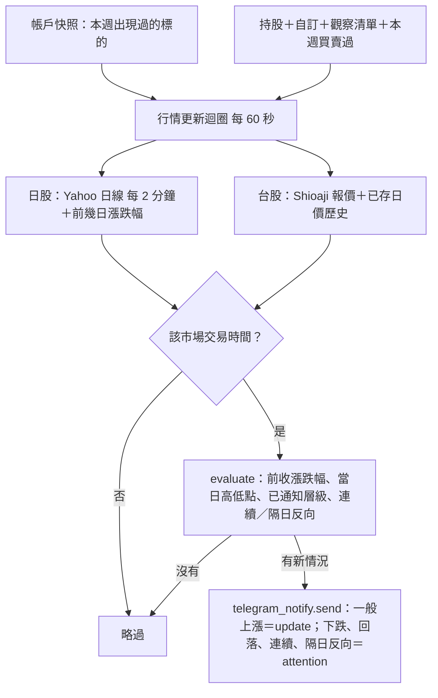

# 盤中漲跌警示（Telegram）

2026-11-16。盤中個股急漲急跌時，用 Telegram 通知擁有者（同 `/market/notify` 的 bot 與 chat）。

## 範圍：台股＋日股

- 台股（`market=TW`）：Shioaji 即時報價，週一到週五 09:00–13:30（台北）。
- 日股（`market=JP`，如 6834）：IBKR 持股沒有盤中行情，改用 Yahoo 日線圖（`{code}.T`）每 2 分鐘輪詢，週一到週五 09:00–15:30（東京）。Yahoo 是非官方來源，雲端 IP 被擋或改版時會略過並記 log，不影響其他功能。
- 美股等其他海外持股不警示（沒有行情來源）。日股、美股代號不會再送去 Shioaji（否則會對到同號的台股）。
- 對象：持股、自訂標的、觀察清單，**加上本週（週一 00:00 台北起）持有或買賣過的標的**——賣掉之後本週內仍會警示。依帳戶快照（約每小時一次）判斷，同一小時內買進又賣出的看不到。

## 規則

| 情況 | 訊息 | 說明 |
|---|---|---|
| 漲超過 5%（再 7%、9% 各一次） | ✅ 盤中上漲 | 相對前一日收盤 |
| 跌超過 5%（再 7%、9% 各一次） | ⚠️ 盤中下跌 | 相對前一日收盤 |
| 自盤中高點回落 5 個百分點 | ⚠️ 自盤中高點回落 | 例：最高 +10% → 現在 +5%，雖然還漲 5% 也通知 |
| 自盤中低點反彈 5 個百分點 | ✅ 自盤中低點反彈 | 例：最低 −10% → 現在 −5% |
| **連續兩天以上同向 ±5%** | ⚡ 連續 N 天漲／跌超過 5% | 前幾天的單日漲跌幅都列在訊息裡；一律 ⚠️ 等級 |
| **隔天反向 ±5%** | ⚡ 隔日反向 | 前一日 +6%、今天 −5%（或相反）；一律 ⚠️ 等級 |

- 「連續」「隔日反向」是在當天第一次越過 ±5% 的那則通知上特別標註，不另外多發一則。單日幅度用收盤對前收；台股歷史取自已存的 TWSE／TPEx 日價，日股取自 Yahoo 日線。
- 每個情況每天只通知一次。回落／反彈通知後，高低點會重設到當下；創新高會重新啟動回落監控。
- 快照時間不是今天（休市日）就忽略；期貨不監控。

## 開發方法

- 規則寫成純函式 `evaluate(state, quote, now)`（`maya_sawa/services/intraday_alerts.py`），TDD：`tests/market/test_intraday_alerts.py` 先寫各情境的漲跌路徑。
- `IntradayAlertMonitor` 在 `ShioajiMarketService.refresh_cache_now` 取得報價後呼叫，失敗只記 log，不影響行情更新。
- 狀態存記憶體：服務重啟後同一交易日可能重複通知一次已達的層級。
- 要調整門檻：改 `LEVELS`、`SWING`。
