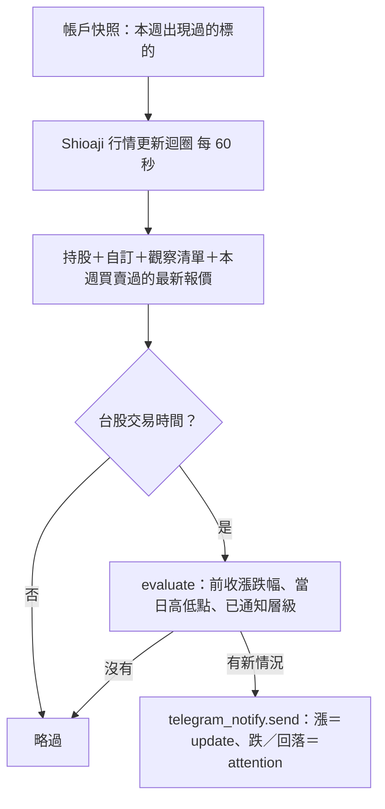

# 盤中漲跌警示（Telegram）

2026-11-16。盤中個股急漲急跌時，用 Telegram 通知擁有者（同 `/market/notify` 的 bot 與 chat）。

## 規則（只看台股，週一到週五 09:00–13:30）

| 情況 | 訊息 | 說明 |
|---|---|---|
| 漲超過 5%（再 7%、9% 各一次） | ✅ 盤中上漲 | 相對前一日收盤 |
| 跌超過 5%（再 7%、9% 各一次） | ⚠️ 盤中下跌 | 相對前一日收盤 |
| **自盤中高點回落 5 個百分點** | ⚠️ 自盤中高點回落 | 例：最高 +10% → 現在 +5%，雖然還漲 5% 也通知 |
| 自盤中低點反彈 5 個百分點 | ✅ 自盤中低點反彈 | 例：最低 −10% → 現在 −5% |

- 每個情況每天只通知一次。回落／反彈通知後，高低點會重設到當下，要再走一段 5 點才會再通知；創新高會重新啟動回落監控。
- 監控對象：持股、自訂標的、觀察清單，**加上本週（週一 00:00 台北起）持有或買賣過的標的**——賣掉之後本週內仍會警示。依帳戶快照（約每小時一次）判斷，所以買進又在同一小時內賣出的不會被看到。
- 快照時間不是今天（平日休市日）就忽略；期貨不監控。

## 開發方法

- 規則寫成純函式 `evaluate(state, quote, now)`（`maya_sawa/services/intraday_alerts.py`），TDD：`tests/market/test_intraday_alerts.py` 先寫各情境的漲跌路徑。
- `IntradayAlertMonitor` 在 `ShioajiMarketService.refresh_cache_now` 取得報價後呼叫，失敗只記 log，不影響行情更新。
- 狀態存記憶體：服務重啟後同一交易日可能重複通知一次已達的層級。
- 要調整門檻：改 `LEVELS`、`SWING`。
