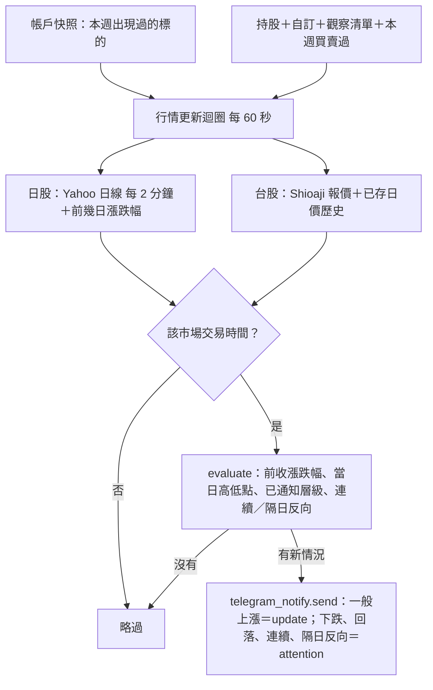
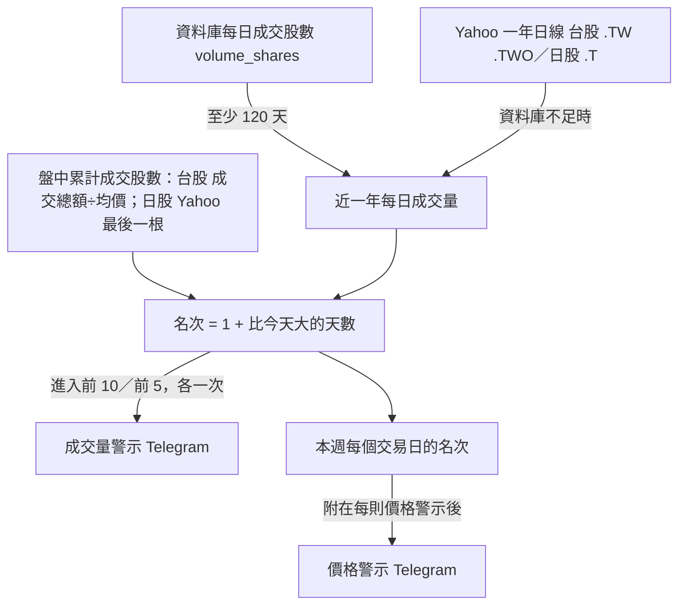

# 盤中漲跌警示（Telegram）

2026-11-16。盤中個股急漲急跌時，用 Telegram 通知擁有者（同 `/market/notify` 的 bot 與 chat）。

## 範圍：台股＋日股

- 台股（`market=TW`）：Shioaji 即時報價，週一到週五 09:00–13:30（台北）。
- 日股（`market=JP`，如 6834）：IBKR 持股沒有盤中行情，改用 Yahoo 日線圖（`{code}.T`）每 2 分鐘輪詢，週一到週五 09:00–15:30（東京）。Yahoo 是非官方來源，雲端 IP 被擋或改版時會略過並記 log，不影響其他功能。
- 美股等其他海外持股不警示（沒有行情來源）。日股、美股代號不會再送去 Shioaji（否則會對到同號的台股）。
- 對象：持股、自訂標的、觀察清單，**加上本週（週一 00:00 台北起）持有或買賣過的標的**——賣掉之後本週內仍會警示。依帳戶快照（約每小時一次）判斷，同一小時內買進又賣出的看不到。

## 規則

| 情況 | 訊息 | 說明 |
|---|---|---|
| 漲超過 5%（再 7%、9% 各一次） | ✅ 盤中上漲 | 相對前一日收盤 |
| 跌超過 5%（再 7%、9% 各一次） | ⚠️ 盤中下跌 | 相對前一日收盤 |
| 自盤中高點回落 5 個百分點 | ⚠️ 自盤中高點回落 | 例：最高 +10% → 現在 +5%，雖然還漲 5% 也通知 |
| 自盤中低點反彈 5 個百分點 | ✅ 自盤中低點反彈 | 例：最低 −10% → 現在 −5% |
| **連續兩天以上同向 ±5%** | ⚡ 連續 N 天漲／跌超過 5% | 前幾天的單日漲跌幅都列在訊息裡；一律 ⚠️ 等級 |
| **隔天反向 ±5%** | ⚡ 隔日反向 | 前一日 +6%、今天 −5%（或相反）；一律 ⚠️ 等級 |

- 「連續」「隔日反向」是在當天第一次越過 ±5% 的那則通知上特別標註，不另外多發一則。單日幅度用收盤對前收；台股歷史取自已存的 TWSE／TPEx 日價，日股取自 Yahoo 日線。
- 每個情況每天只通知一次。回落／反彈通知後，高低點會重設到當下；創新高會重新啟動回落監控。
- 快照時間不是今天（休市日）就忽略；期貨不監控。

## 開發方法

- 規則寫成純函式 `evaluate(state, quote, now)`（`maya_sawa/services/intraday_alerts.py`），TDD：`tests/market/test_intraday_alerts.py` 先寫各情境的漲跌路徑。
- `IntradayAlertMonitor` 在 `ShioajiMarketService.refresh_cache_now` 取得報價後呼叫，失敗只記 log，不影響行情更新。
- 狀態存記憶體：服務重啟後同一交易日可能重複通知一次已達的層級。
- 要調整門檻：改 `LEVELS`、`SWING`。

## 成交量警示（2026-11-16）

每檔股票的成交量都跟自己「近一年（約 250 個交易日，不含今天）」的每日成交量比名次。

| 情況 | 訊息 |
|---|---|
| 今日累計成交量進入近一年**前 10 大** | ⚠️ 成交量進入近一年前 10 大（第 N 名）：列出前 10／前 5 的門檻股數與本週每天的名次 |
| 再進入**前 5 大** | ⚠️ 成交量進入近一年前 5 大（第 N 名） |
| **任何價格警示**（漲跌、回落、反彈、連續、隔日反向） | 訊息最後多一段：今日成交量名次與「進入前 5／前 10／未進前 10」，以及**本週每個交易日**的名次 |

- 為什麼本週每天都列：漲停或跌停鎖死時成交量常常很小，只看今天會漏掉；所以價格波動達 ±9.5% 以上時，另外提醒「漲跌停時成交量常很小，所以本週各日都列出」。
- 名次 = 1 + 近一年中比它大的天數（同量不往後排）。歷史不足 120 個交易日不發成交量警示，價格警示也不附成交量段。
- 今日成交量是**盤中累計**，和完整交易日比，早盤量小是正常的；它進入前 10／前 5 代表盤中就已經爆量。
- 台股盤中累計股數 = Shioaji 成交總額 ÷ 成交均價（不直接用快照的成交量，因為張與股的單位不確定）；日股取 Yahoo 日線最後一根的成交量。

資料來源：先用資料庫已存的每日成交股數（證交所／櫃買每日行情，`volume_shares`）；資料庫預設只回填 92 天，不足 120 天就改用 Yahoo 一年日線。要完全用資料庫，把 `MARKET_HISTORY_BACKFILL_DAYS` 調到 366。

開發方法：名次與本週摘要是純函式（`maya_sawa/services/volume_rank.py`），先寫 `tests/market/test_volume_alerts.py`（名次、門檻、各一次、價格警示附註、本週列表、資料不足、單位換算、Yahoo 解析、資料庫不足改 Yahoo）再實作。

## 2026-11-16 加權指數（TAIEX）

加權指數和個股一樣會推 Telegram 警示：漲跌幅、盤中回落／反彈、連續與隔日反向。指數波動比個股小，所以門檻較低：漲跌 2%、3%、5% 各通知一次，自高低點回落或反彈 2 點，連續／反向的「大日」是 3%。

- 資料：Yahoo `^TWII`，台北盤中每 60 秒最多讀一次（`IntradayAlertMonitor.check_index`，掛在 Shioaji 報價刷新後）；訊息標題為「TAIEX 加權指數」。
- 規則仍是純函式 `evaluate`，門檻由報價自帶的 `levels`、`swing`、`bigDay` 決定，個股預設不變。
- **尚未做：指數成交量排名。** Yahoo 盤中不提供 ^TWII 當日累計成交量（當日值為 0），而全市場成交金額需要另一個盤中來源（Shioaji 指數快照的成交金額，或證交所盤中統計）與歷史成交金額；來源與單位確認前不推「爆大量」，避免誤報。

## 儀表板「大量」標記的範圍（2026-11-18）

本週成交量進入近一年前 10 名就標「大量 · 年度前 10」，前 5 名標「爆大量 · 年度前 5」（`volume_rank.flag_for`）。標記的股票範圍與 Telegram 警示相同：持股、自訂、觀察，**加上本週交易過、現已賣出的股票**（`market_company_events.event_symbols`）。先前只涵蓋前三項，所以賣出後的股票（例如創意 3443）收得到警示、儀表板卻沒有標記。
