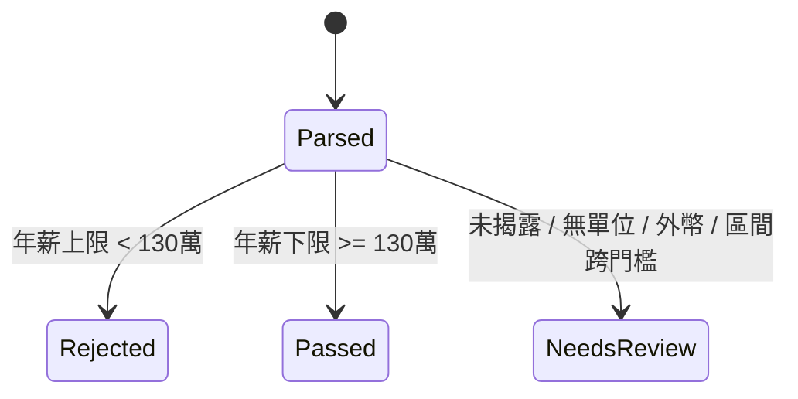

# Gmail 職缺通知（CakeResume）＋薪資門檻

只讀取 Gmail（`gmail.readonly`），不寄信、不改信。年薪 < NT$1,300,000 直接擋；薪資未揭露或無法換算 → 待審核；達標才可進下一階段。

## 架構圖

```mermaid
flowchart LR
    G[Gmail<br/>notifications@no-reply.cake.me] -->|users.messages.list/get 輪詢| P[poller.poll_once]
    P -->|寄件者精確比對| C[cake_parser.parse_cake_alert]
    C --> S[salary.evaluate_salary]
    S -->|PASSED| N[進下一階段]
    S -->|NEEDS_REVIEW| R[人工審核]
    S -->|REJECTED| X[丟棄]
    P -.已處理 message id.-> ST[(~/.maya-sawa/gmail/state.json)]
```



## 使用

```powershell
cd maya-sawa
poetry run python scripts/job_alerts_gmail.py auth   # 一次性，瀏覽器授權
poetry run python scripts/job_alerts_gmail.py poll   # 列出新信的職缺與判定
```

憑證：`~/.maya-sawa/gmail/client_secret.json`、`token.json`（repo 之外，勿提交）。

## 開發方法

1. 選輪詢而非 Pub/Sub push：Cake 信量小，輪詢不需常駐接收端與每 7 天續約 watch；穩定後可再升級。
2. GCP 專案 `oauth-423403`：啟用 Gmail API、Pub/Sub API（後者暫時用不到），建立「桌面應用程式」OAuth 用戶端 `maya-sawa-gmail-job-alerts`。
3. 先寫失敗測試再實作：薪資解析（月薪/年薪/萬/K/M/`/年`）、門檻判定、Cake 信件 HTML 解析（fixture 來自真實信件，追蹤連結已去除）、輪詢冪等與寄件者偽造。
4. 規則：無單位標示的數字不猜月薪或年薪 → 待審核；外幣 → 待審核；寄件者必須完全等於 `notifications@no-reply.cake.me`。
5. 密鑰：只放使用者家目錄，scope 僅 `gmail.readonly`。
6. 之後類似整合：先拿一封真實信存成 fixture → 寫解析測試 → poller 用可注入的假 client 測。

## 測試

`poetry run python -m pytest tests/test_job_alerts_salary.py tests/test_job_alerts_cake_parser.py tests/test_job_alerts_poller.py`

已知缺口：未對真實 Gmail 做端到端（需先完成 `auth`）；Cake「查看 N 筆」摘要連結不解析；多單位（如 13 個月）不換算。
