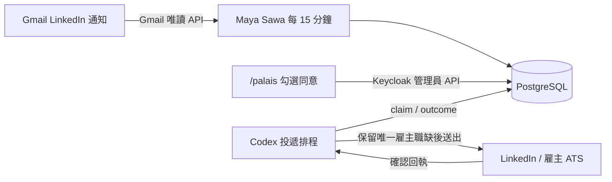
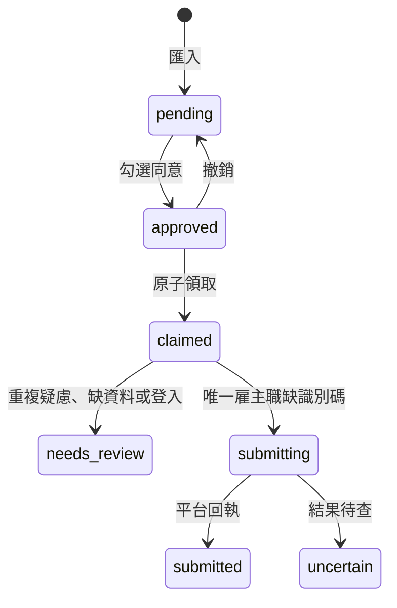

# LinkedIn 職缺與投遞

每 15 分鐘由 Maya Sawa 用 Gmail 唯讀 API 匯入最近 30 天的職缺通知。已匯入的 Gmail message ID 和 LinkedIn 職缺 ID 存在 market dashboard PostgreSQL。/palais 用 Keycloak 管理權限讀取及核准職缺。Codex 投遞排程每兩小時以專用金鑰領取一筆已核准職缺。

## 憑證與部署

- 完成 Gmail 唯讀 OAuth 同意後，將 refresh token 與 OAuth 用戶端資料放入 Maya Sawa 命名空間的 `linkedin-gmail` Secret，鍵名為 `client_id`、`client_secret`、`refresh_token`。Pod 啟動時讀取環境變數 `LINKEDIN_GMAIL_*`。三項齊全才會輪詢，重新部署後生效。OAuth client 設定及本機授權方式見 [Gmail 授權說明](JOB_ALERTS_GMAIL.md)。
- 本機 Codex 排程從使用者私有檔 `~/.maya-sawa/gmail/linkedin_apply_key` 讀取 `X-LinkedIn-Apply-Key`。部署只放 SHA-256。該金鑰不具備核准權限。
- 在正式環境開啟收信之前，先確認 owner API 的 GET 可以看見既有資料、無權限時回傳 401/403，以及空佇列的 claim 回傳空值。初次匯入以待審核狀態寫入。沒有核准資料時，排程不接觸 ATS。

## 開發方法

1. 2026-11-19 先測同職缺重刊、跨平台的雇主 requisition 去重與只有已核准職缺可領取。以郵件和職缺的主鍵維持重跑一致性。領取用條件更新，最終送出要先寫入 submitting 及雇主職缺的唯一識別碼。識別碼採小寫，包含雇主或 ATS tenant 及原始 requisition ID。
2. 核對 ATS 和 Gmail 申請回執後才保留送出資格。領取後卡住、送出結果未知、或回執遺失時，保留現有狀態供人工查核。排程不會自動把這些資料放回待投遞佇列。
3. 以去除個資的 LinkedIn 郵件樣本測 MIME 職缺抽取與 Gmail 分頁。管理頁透過既有 Astro 內網代理呼叫 API。只在確認送出後寫入申請編號或平台回執文字，不存履歷或表單個資。

## 測試

`poetry run python -m pytest tests/job_alerts -q` 覆蓋解析、分頁、匯入冪等、核准後才能領取及跨平台重複阻擋。正式 Gmail OAuth 與 ATS 送出需以部署後的授權帳號驗證。
