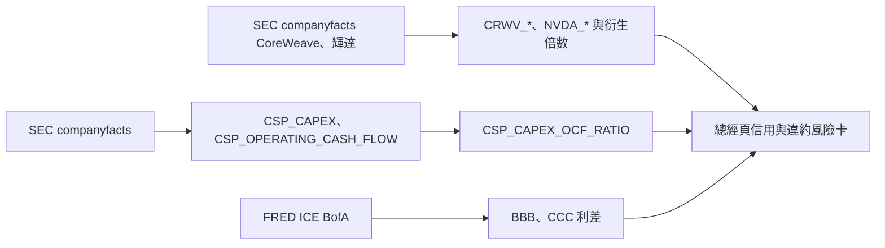

# 總經資料完整性：預期歷史長度

ty-backend 每週掃描 `/maya-sawa/market/dashboard/macro`，檢查每條序列是否有三年歷史。這份文件記錄每條序列「應該有多長、為什麼」，讓掃描結果只對真正的退步或故障發出提醒。

## 掃描端必須遵守

- 一定要帶 `historyMonths=60`。預設是 24 個月，API 會依頻率截短歷史（日資料約 `月數 × 32` 筆，月資料至少 24 筆）。2026-11-20 試掃用預設值，31 條不足；改用 60 後只剩 24 條。
- 期別有四種格式：`YYYY`（年資料，例如人口、TIER 預測）、`YYYY-MM`、`YYYY-Qn`、`YYYY-MM-DD`。只寫年份的不是「無有效歷史」，應視為該年 12 月 31 日。
- 三年的邊界要放寬幾天：剛好從三年前同一天開始的序列（ICE BofA 利差 2023-11-20 起）不算不足。

## 不足三年的原因（2026-11-20，historyMonths=60）

| 類別 | 序列 | 原因 | 處理 |
|---|---|---|---|
| 已延長抓取 | `POLICY_RATE_*`（美、歐、日、韓、台） | BIS 原本只抓 730 天 | 2026-11-20 改成 4 年，下次抓取補齊 |
| 已延長抓取 | `TW_EMPLOYED`、`TW_UNEMPLOYED`、`TW_UNEMPLOYMENT_RATE` | 主計總處原本只抓 2 年 | 改成 4 年 |
| 已延長抓取 | `TW_TAIEX_BIAS_60/120/240` | 由存下的加權指數收盤價（FMTQIK）算，收盤價原本只回補 37 個月，再扣均線暖機期 | 收盤價回補改成 49 個月；可接受的起點 = 收盤價起點 + 均線暖機期 |
| 已延長抓取 | `TW_MARGIN_MAINTENANCE`、`TW_MARGIN_BALANCE` | 原本只回補一年內，每次最多 60 天 | 回補範圍改成約 3 年；每次仍 60 天，約兩週內補齊 |
| 來源限制 | `TW_VIX` | 期交所只保留約 4 個月的月檔，只能從存下的資料往後累積 | 預期隨時間變長，不可回補 |
| 來源限制 | `TW_PMI` | 中經院趨勢頁只列約 12 個月 | 預期隨時間變長 |
| 來源限制 | `UMICH_CPI_EXPECTED_1Y` | 密西根大學的表格檔只給近 13 個月 | 預期隨時間變長 |
| 來源限制 | `TW_MARGIN_CALL_ACCOUNTS` | 證交所儀表板只回傳近 60 個交易日 | 預期隨時間變長 |
| 來源限制 | `TPEx_GOLD_TWD` | 櫃買只公布最新一筆 | 預期隨時間變長 |
| 刻意保留短 | `TX_CALENDAR_SPREAD`、`TX_ROLL_EXCESS_SPREAD` | 合理價差用今天的股本與指數除數，往回推太久會失真 | 維持 13 個月 |
| 刻意保留短 | `TW_MARKET_PE` | 要逐日用全部個股本益比計算，回補成本高 | 往後累積 |
| 刻意保留短 | `VIX_FUT_FRONT` | 每天一個請求，只抓 45 天 | 往後累積 |
| 本質如此 | `TIER_TW_GDP_FORECAST`、`TIER_TW_CPI_FORECAST` | 預測只有今年與明年 | 永遠 2 點 |

## 建議的提醒規則

- 符合上表預期：不提醒。
- 0 點、最新一期過期，或比上週變短：當成故障提醒。
- 「已延長抓取」那幾條在部署後一到兩週內仍不足三年：提醒，代表回補沒有成功。
- 每週只報與上週相比的變化。

## 美股指數乖離率

## 開發方法

1. 費半採用 Yahoo Finance 的 `^SOX` 指數日收盤，沿用 S&P 500 的資料來源與更新排程，無需新增憑證。採集最近五年的收盤價，每條乖離率會扣除前 `窗口 − 1` 個交易日。
2. 沿用既有的移動平均算法，將四種百分比序列存入總經快取。測試先用 Yahoo 格式的固定回應驗證資料識別、均線計算與快取註冊。
3. 部署後由下一次既有的總經資料更新回補。從總經 API 帶 `historyMonths=60` 檢查 `US_SOX_BIAS_20/60/120/240`，再核對圖表的均線選單和日期讀值。

測試指令為 `poetry run python -m pytest tests/market/macro/test_market_macro_sources.py tests/market/test_taiex_bias.py -q`。

## AI 融資供應鏈指標（2026-11-22）

- `CSP_CAPEX_OCF_RATIO`：五家雲端大廠資本支出 ÷ 營業現金流（%），由 `CSP_CAPEX` 與 `CSP_OPERATING_CASH_FLOW` 在每次 SEC 抓取時衍生，只算兩者都有的季度。超過 100 代表擴建花費超過當季本業現金，缺口要靠舉債或外部資金。
- `BAMLC0A4CBBB`（BBB 級）、`BAMLH0A3HYC`（CCC 級以下）：ICE BofA 利差，走既有 FRED 流程。CCC 利差對高槓桿的新興雲端業者（如 CoreWeave）最敏感，但不等於其個別債券殖利率。
- CoreWeave（SEC companyfacts，CIK 1769628）：`CRWV_DEBT`、`CRWV_CASH`、`CRWV_DEBT_DUE_12M`（12 個月內到期本金）、`CRWV_RPO`（合約積壓）、單季 `CRWV_OPERATING_CASH_FLOW`、`CRWV_CAPEX`、`CRWV_INTEREST_EXPENSE`，以及衍生的 `CRWV_CASH_TO_DEBT_DUE_12M`（現金 ÷ 12 個月內到期本金，倍）與 `CRWV_OCF_TO_CAPEX`（%）。現金倍數低於 1 代表要靠再融資或展延。2026-09 讀數約 0.38 倍（現金 41 億對 110 億到期）。
- 輝達（CIK 1045810）：`NVDA_NON_MARKETABLE_EQUITY`（非上市股權投資）、`NVDA_GUARANTEE_EXPOSURE`（擔保最大曝險，2026-09 約 1,085 億）、`NVDA_OPERATING_CASH_FLOW`。輝達會計年度在 1、4、7、10 月底結束，按最近的曆年季度對齊。
- 這些是申報數字，每季才更新，且每天最多抓一次（兩個請求）。只保留最近 20 季。CoreWeave 2025 年才上市，序列不足三年，輝達擔保曝險只有兩筆，都列在 ty-backend `KNOWN_SHORT` 避免每週誤報。
- 尚未涵蓋：輝達對個別客戶的投資明細與採購承諾（SEC 數值欄位不全）、CoreWeave 債券殖利率（無免費來源）、通電率。

## 重啟不重抓（FRED）
每次成功的 FRED 呼叫都在 `maya_sawa_macro_fetch_runs.detail` 記下抓了什麼（`series:DGS10`、`dates:10`）。
下一次刷新先查 `succeeded_within`：日頻序列與公布日期 5.5 小時內、其他頻率 24 小時內成功過就直接用 PostgreSQL 的資料，不打 FRED。
所以 pod 重啟、部署都不會再花 FRED 呼叫；只有 6 小時一輪的例行刷新會真的去抓。
背景：2026-11-27 一天五次部署，每次重啟重抓約 39 次，把自設的每日上限（200）用完；之後已取消 FRED 每日上限，只保留每分鐘 60 次（FRED 官方限每分鐘 120 次），經濟數據行事曆因此沒更新。
