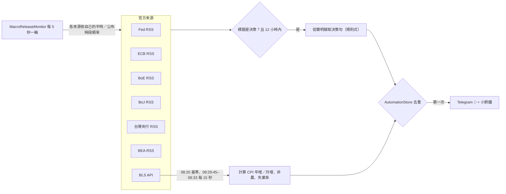

# 總經公布即時通知（第一期）

`maya_sawa/services/macro_releases.py`：央行利率決策與美國重大數據一公布，幾秒內送 Telegram（📢）並存一份到網站小鈴鐺。
全部來自官方來源、不經 AI；AI 排程仍負責之後的深度解讀。

| 來源 | 比對標題 | 摘要 | 平時 | 公布時段（當地時間）|
|---|---|---|---|---|
| Fed | issues FOMC statement | 擷取 "The Committee decided to … federal funds rate … percent" | 2 分 | 週三 13:59–14:20 紐約，每 5 秒 |
| ECB | Monetary policy decisions（**待真實決策日驗證**）| "The Governing Council decided to …" | 5 分 | 週四 14:14–14:35 法蘭克福，每 10 秒 |
| BoE | Bank Rate maintained/increased/reduced | 標題本身 | 5 分 | 週四 11:59–12:20 倫敦 |
| BoJ | Statement on Monetary Policy | 標題＋連結 | 5 分 | 平日 11:30–13:30 東京，每 20 秒 |
| 台灣央行 | 理監事聯席會議決議（排除議事錄）| feed 內文的重貼現率句 | 30 分（feed 1.7 MB）| 3/6/9/12 月週四 15:59–16:30 台北 |
| BEA | GDP…／Personal Income and Outlays（排除州郡）| 標題＋連結 | 10 分 | 平日 08:29–08:40 紐約 |
| BLS | API 5 個序列 | CPI 年增（含前值）、核心 CPI、季調月增、非農增減、失業率 | — | 平日 08:29:45–08:33 紐約 |

台北時間對照：美國 08:30 數據＝夏令 20:30／冬令 21:30；FOMC＝夏令 02:00／冬令 03:00。

## 開發方法與注意
- 純函式都有測試（`tests/market/test_macro_releases.py`）：feed 解析、決策標題比對、擷取句、新鮮度、時段、BLS 計算、去重。
- BLS 無金鑰每天 25 次：基準 1 次＋時段內 13 次。設 `BLS_API_KEY`（免費註冊）可提高額度。08:20–08:29 沒跑到基準（例如剛好重啟）當天就不發 BLS，避免把舊數據當新的。
- 前一年同月缺值（例如 2025-10 CPI 因停擺未公布）就不寫年增率，不推估。
- 去重 key 存在 `maya_sawa_market_routine_fire`（日期 1970-01-03）；Telegram 失敗會釋放，下一輪重送。沒有日期的 feed 項目第一輪只當基準不發。
- 第二期：公開資訊觀測站重大訊息、SEC 8-K；第三期：一般新聞 + Gemini Flash 摘要（已決定用 Gemini）。
