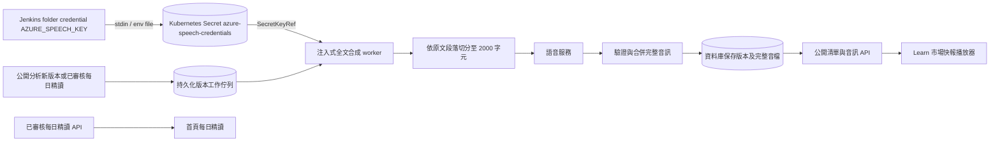
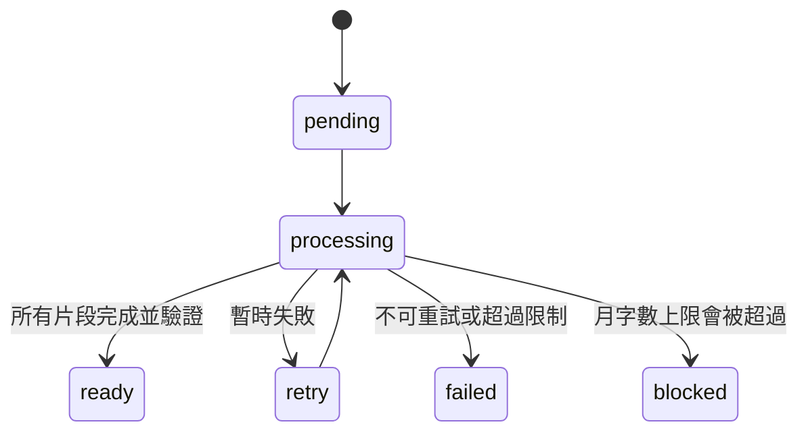
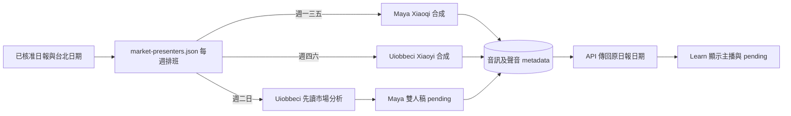
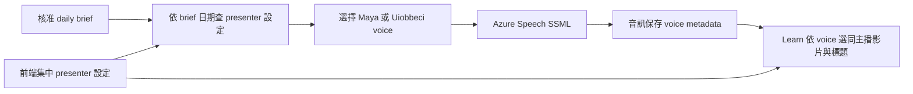
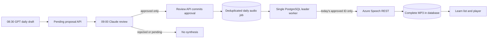
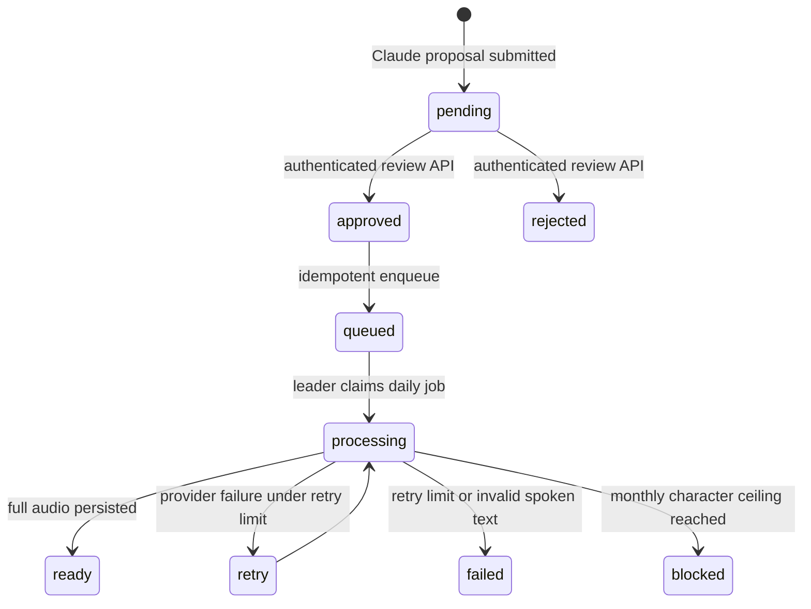

# 市場快報語音（準備中）

市場語音唯讀 API 現已接入服務，Learn 頁會列出已完成的語音並播放資料庫中的完整音檔。版本佇列、Azure Speech REST provider、全文分段/MP3 合併及月字數預留閘門已實作並測試；正式環境透過 Jenkins folder credential `AZURE_SPEECH_KEY` 安全建立 Kubernetes Secret，再由 deployment 的 SecretKeyRef 注入。`MARKET_AUDIO_AZURE_ENABLED`、`MARKET_AUDIO_AUTOGEN_ENABLED` 預設仍關閉，月字數上限為 0；不會因部署 credential 而啟動自動合成。

## 預定資料流程

## 接線與成本控制實作補充

1. 確認用戶提供的總經評論是完整版本，而不是只轉換新增段落。新分析版及已審核每日精讀會依版本入持久化佇列；worker 對完整來源文字合成，完成後寫入完整音檔。版本 id 去重，內容雜湊不同則拒絕覆寫。
2. 先以測試固定分段不遺漏文字、百分比與小數不能在小數點切開，再實作分段。
3. Azure 資源 `ty-multiverse-speech-f0` 位於 `eastus`、F0；語音目錄選中「Xiaoyu Dragon HD Flash Latest」，voice 為 `zh-CN-Xiaoyu:DragonHDFlashLatestNeural`。Microsoft 語音目錄將此 voice 類別列為 Neural HD Flash。官方 F0 價格頁只將每月 50 萬字元免費列在 `Neural` 項下，沒有明文證實 HD Flash 可用同一免費額度；不可把 50 萬免費字元視為 HD Flash entitlement。Microsoft East US Retail Prices API 目前列 Standard Neural / Neural HD Flash 分類為 USD $15 / 百萬字元，Neural HD 為 USD $22 / 百萬字元；這是 PAYG 零售 list rate，不能證明個別 F0 訂閱會對 HD Flash 免費或實際發票費用。若無免費 entitlement，保守按 $15/M 估算，不得把本地字元 cap 宣稱為美元硬上限。Azure Portal 當前網路設定為「Selected networks」，IPv4 allowlist 僅有 OKE SSH 節點出口 `140.245.44.81`；OKE SSH 實測出口亦為同一 IP。
4. 官方 TTS REST 支援依資源區域選 regional endpoint；此資源使用 `https://eastus.tts.speech.microsoft.com/cognitiveservices/v1`、`Ocp-Apim-Subscription-Key`、SSML 和 MP3 output。公開 Selected Networks/IP allowlist 模式使用此 endpoint，不需 custom domain；Microsoft 的 custom domain 指引是 Private Endpoint/Private Link 情境，若後續改用私有端點必須改 endpoint/DNS。2026-11-04 已由 OKE node 單次合成並由 FFmpeg 解碼；DB worker 保存全文，再經公開 API 和 Learn 播放器實際播放到 188.304 秒結尾。
5. key 只由 `AZURE_SPEECH_KEY` 注入，region 由環境設定。provider 分段完整來源文字，使用 FFmpeg concat demuxer stream-copy 合併 MP3，而非直接串接 MP3 bytes；每個請求間隔保守 3.1 秒，避免超過 F0 每分鐘 20 個 synthesis request 的公開限制。單元測試用 FFmpeg 生成兩段獨立 MP3，合併後用 FFmpeg 完整解碼並用 ffprobe 核對時長。
5. `MARKET_AUDIO_AUTOGEN_ENABLED` 與 `MARKET_AUDIO_AZURE_ENABLED` 在 production deployment 都明確設為 `false`，`MARKET_AUDIO_MONTHLY_CHARACTER_LIMIT=0`。worker 只會在兩個旗標、key、支援區域和正數月字數上限都存在時啟動。PostgreSQL advisory lock 限制整個叢集同一時間只有一個 worker，並以 3.1 秒間隔限制 F0 request 頻率。月字數在每次外部請求前以資料庫原子預留（重試也計入），超過上限時不呼叫 provider，工作標記為 `blocked`。這是本地字元 ceiling，**不是 $1 美元硬上限**；沒有經核實的實際 rate 前不得把它換算或宣稱為美元保證。Azure 預算警報同樣不保證停止消費。

測試：後端 `poetry run python -m pytest tests/market/test_market_audio_azure.py tests/market/test_market_audio_merge.py tests/market/test_market_audio_worker.py tests/market/test_market_audio_api.py tests/market/test_market_audio_db.py tests/market/test_audio_text.py tests/market/test_daily_maya_api.py tests/market/test_daily_maya_db.py tests/market/test_daily_maya_sources.py tests/market/test_daily_maya_editorial.py tests/market/test_market_audio_deployment_secret.py -q`（36 passed）。部署憑證測試固定 key 必須來自 Kubernetes Secret、worker 預設關閉且 Jenkins 要透過 stdin 建立 Secret，禁止把 key 放入命令列 literal。前端以 Codex Node 24 執行 `node_modules/vitest/vitest.mjs run tests/market/dailyMayaRoutes.test.ts tests/seo/homeSeo.test.ts`（10 passed）。真實短句 TTS 和 MP3 完整性已由 OKE 驗證；F0 免費額度對 HD Flash 的適用性及個別資源實際帳單仍需 Azure 用量/帳單核實。

## 開發方法

### 每日主播與雙人日市場稿（2026-11-05）

以 `config/market-presenters.json` 為設定來源：Maya `zh-CN-Xiaoqi:DragonHDFlashLatestNeural`，Uiobbeci `zh-CN-XiaoyiNeural`；週二、週日為 Duo，市場稿先以 Uiobbeci 發聲並記為 `duo:uiobbeci:maya-pending`，未生成 Maya 稿。已核准稿的原始日期由公開音訊 API 附上，重製時間不影響排班。先測七日排班、Duo 聲音與 pending metadata，再以 Azure 真實短句驗證 Xiaoqi；金鑰來自既有 Kubernetes Secret，不寫日誌或 Git。重製歷史稿時先備份現有完整音檔，再驗證稿件與合成，所有新音檔完成後才可在單一資料庫交易中替換；保留舊來源與新的計費字元預留，避免中途失敗讓清單空白。兩篇不符口播檢查的舊稿必須人工整理成保留不確定性與限制的摘要，保留稿件 ID 和來源，不將文件語句直接送 TTS。測試 `poetry run python -m pytest tests/market/test_market_presenters.py tests/market/test_market_audio_worker.py tests/market/test_market_audio_api.py tests/market/test_market_audio_azure.py -q`。Duo 的 Maya 片段、稿件以及雙人逐段切換仍待後續定義。

### Presenter schedule and voice selection

2026-11-05 修正：使用者提供的 Speech Studio 截圖為「曉伊」，風格為預設及 `affectionate`、`angry`、`cheerful`、`disgruntled`、`embarrassed`、`fearful`、`gentle`、`sad`、`serious`，對應標準音色 `zh-CN-XiaoyiNeural`。Uiobbeci 的唯一設定改為該音色；先前 `Xiaoxiao2` 試音並非截圖音色。先以設定測試重現錯誤，再更新 JSON、worker 和 API 測試。使用既有 Azure Secret 合成兩筆測試的 revision 2：單人使用曉伊，雙人前半使用 Maya 的 Xiaoyu、後半使用曉伊，兩段各約 10.73 秒；先鎖住音訊工作表並確認無 processing 工作，每次合成前依原有帳本預留字元。原 revision 1 保留以便追溯。兩個公開音檔 HTTP 可讀且 FFmpeg 全檔解碼成功；前端僅對 `test:` 錄音顯示最新 revision。語音依照截圖使用預設風格，截圖的「傷心」按鈕不作持續套用。測試：`poetry run python -m pytest tests/market/test_market_presenters.py tests/market/test_market_audio_worker.py tests/market/test_market_audio_api.py tests/market/test_market_audio_azure.py -q`；真實排程仍須在部署後確認新設定已生效。

設定唯一來源：`config/market-presenters.json`（maya-sawa repo）。每週索引為星期一至星期日，預設 Maya、Uiobbeci、Maya、Uiobbeci、Maya、Uiobbeci、Maya；影片檔名與 voice 也在同一設定檔中。後端清單 API 回傳此設定供前端套用；daily worker 以已核准 proposal 的日期挑 voice，舊音訊記錄保留原有 voice metadata；沒有 voice metadata 的舊記錄依相容規則視為 Maya。Azure provider 的預設音色仍是 Maya，只有 daily worker 明確傳入排程音色時才使用新音色，個股與總經音訊不變。

先新增日期排班、voice SSML、worker 分流與前端即時設定套用測試，再接入 provider。執行前端 `node_modules/vitest/vitest.mjs run tests/learn --maxWorkers=1` 與後端 `poetry run python -m pytest tests/market/test_market_audio_azure.py tests/market/test_market_audio_worker.py tests/market/test_market_presenters.py -q`。不用把任何金鑰寫入設定或原始碼；語音 key 仍由 Jenkins Secret 注入。影片檔應分別上傳為 `reporterMaya.mp4` 和 `reporterUiobbeci.mp4`，再用公開 HEAD/GET 和瀏覽器播放確認。不要用非核准稿生成語音；今天沒有已核准稿時，應先完成提案和審稿流程，再由單次受限工作合成，並遵守既有字元預算與 F0 entitlement 限制。

### Automatic approved daily brief synthesis (2026-11-04)

Production auto-generation is enabled for the current Taipei day's approved daily brief only. The worker requires the proposal ID to appear in the daily database's approved records for today's date and filters claims to those IDs; old daily jobs and stock/macro jobs remain queued. A monthly local ceiling of 50,000 billable characters is configured. At the public East US $15/M list rate this is an approximate $0.75 ceiling, before any applicable free quota; it is not an account-level USD hard stop or a guarantee about the actual invoice. Azure usage and billing for Neural HD Flash/F0 must still be checked in the subscription. For each attempt, application logs record billable characters, cumulative reserved characters, estimated list cost, and the rate used. Success, retry, permanent failure and budget blocks log only job IDs/status and exception class; they never log text, credentials, or provider error messages. Inspect `kubectl logs deployment/maya-sawa -n default` for these warnings and correlate with the Azure usage page; the logs are cost estimates, not invoice data.

Repeat this rollout by testing that macro/stock and non-current-day daily jobs remain pending when daily auto-generation is enabled, reviewing the approved-only API callback and duplicate behavior, then deploying the feature flags and a positive character ceiling together. Trigger the normal authenticated proposal/review APIs with a source-verified, non-public test proposal; verify the resulting job, complete database audio row and Learn player. Do not call `process_one` or a targeted worker as a substitute for the API flow. Failed provider attempts are recorded by exception class and count against the monthly character ledger; transient errors retry up to the configured attempt limit, so attempted text is counted even if a retry is needed.

Tests: `poetry run python -m pytest tests/market/test_market_audio_worker.py tests/market/test_market_audio_deployment_secret.py tests/market/test_daily_maya_api.py tests/market/test_market_audio_db.py -q`. API-based production verification is still required after deployment.

1. 先固定分段不切壞數值、音訊必須有完整原文等測試，再做資料庫與唯讀 API；後端啟動時用既有市場資料庫 engine 初始化音訊表並註冊路由。
2. 前端只經同源 Astro server routes 讀公開清單及音訊串流，避免把後端內網位址暴露給瀏覽器；播放器使用 `preload=none`，不會自動下載或觸發 TTS 費用。
3. Azure key 由 Speech resource 取得後只存 Jenkins `vinskao` folder Secret text credential `AZURE_SPEECH_KEY`；Jenkins 綁定時不開 shell trace，以 stdin `--from-env-file=/dev/stdin` 建立 `azure-speech-credentials` Secret，deployment 只透過 SecretKeyRef 引用。禁止把值寫進原始碼、命令列參數、建置日誌或回報。Azure 網路 allowlist 僅保留 `140.245.44.81`。自動合成仍關閉；試音使用 OKE 節點上的單次請求，先核對 SKU 免費用量和費率，不以試音成功推定後續用量免費。
4. 新分析版/已審核每日精讀會排入持久化工作，worker 有重試與失敗上限，REST provider 可注入；自動 worker 預設關閉，且只允許取得 PostgreSQL leader lock 的 pod 啟動。單次試音先從 OKE 節點送短句至 regional TTS endpoint，確認 HTTP、音訊格式和完整解碼後再人工試聽；全文驗證還要比對 source digest，經 Learn 播放到 ended。2026-11-04 已以 34 個中文字取得 41,904-byte MP3，ffprobe 驗證 6.984 秒；按公開 USD $15/M list rate 的非免費估算約 $0.00051，實際是否從 F0 免費額度扣抵尚未核實。只有確認此 voice 的免費 entitlement、訂閱費率和能接受的月字數後，才評估設定自動化旗標及上限。若需 $1 美元硬上限，先以可核對的實際費率做原子美元帳本；字數 cap 不等於美元 cap。

## 2026-11-04 新版每日精讀重製

- 核准稿 `64bf7afc-3cf3-42c3-aaa6-a07cf055f713` 已發布，來源 520 字元。正式 `maya-sawa:272` 的 `prepare_spoken_transcript` 驗證通過，清理結果只合併空白、沒有改變口播文字；計費 516 字元。手動 worker 取得 PostgreSQL advisory lock，只 claim 此一筆並限制單次 ledger ceiling 為 1,466 字元（既有 950 + 本稿 516）。中途一次因手動驗證連線池只有一個連線而在 claim 前 timeout，job 仍為 pending/0 attempts、帳本不變；擴成兩個連線後只成功呼叫 Azure 一次。部署中的兩個 worker flags 仍為 false，環境月上限仍為 0。
- DB job 現為 `ready`、attempt 1，來源 digest 與核准稿一致；voice `zh-CN-Xiaoyu:DragonHDFlashLatestNeural`，`audio/mpeg`，606,960 bytes。`ffprobe` 為 101.160 秒，FFmpeg 完整解碼成功。本機音檔：[新版 520 字每日精讀 MP3](../../.local-evidence/azure-speech-daily-64bf7afc-520char-20261104.mp3)。公開音訊 GET 回 HTTP 200、`audio/mpeg`、606,960 bytes；Learn 清單將新版列在第一筆。
- Learn 頁原生播放器已開始播放，但兩度在約 40 秒及 65 秒附近停住；最後觀察為 `paused=true`、`ended=false`、`duration=null`、`readyState=4`。因此已證實音檔可完整解碼並可由公開路由播放，**尚未證實 Learn 播放器全程到結尾**。不要將此輪寫成完整播放器試聽成功。
- 若以 East US USD $15/M list rate 估算，這次 516 字約 $0.00774，累計保留 1,466 字約 $0.02199；非實際帳單與免費額度認定。HD Flash 的 F0 50 萬免費 entitlement 及本資源實際費率仍無帳戶用量/帳單佐證，自動合成繼續關閉。

官方核對（2026-11-03）：[HD Flash voice 清單與 API 適用性](https://learn.microsoft.com/en-us/azure/ai-services/speech-service/high-definition-voices)、[Speech TTS REST endpoint 與 request 格式](https://learn.microsoft.com/en-us/azure/ai-services/speech-service/rest-text-to-speech)、[Azure Speech 價目](https://azure.microsoft.com/en-us/pricing/details/speech/)、[East US Azure Speech 零售費率 API](https://prices.azure.com/api/retail/prices?$filter=armRegionName%20eq%20%27eastus%27%20and%20contains(productName,%27Azure%20Speech%27)、[Private Endpoint 的 custom-domain 規則](https://learn.microsoft.com/en-us/azure/ai-services/speech-service/speech-services-private-link)。官方公開額度不會顯示本資源剩餘免費量；F0 是否免費涵蓋 HD Flash 仍需帳戶用量/帳單佐證。

## 2026-11-04 正式環境即時合成驗證

- Jenkins `vinskao/maya #268` 成功部署 commit `b026d59`，OKE `maya-sawa` rollout Ready 1/1，映像標籤 `268`。Jenkins folder credential `AZURE_SPEECH_KEY` 透過不開 shell trace 的 stdin env-file stage 建立 K8s Secret `azure-speech-credentials`；Deployment 以 SecretKeyRef 注入。
- Azure 網路設定當時為 `Selected networks`，IPv4 allowlist 唯一項目 `140.245.44.81`；OKE SSH node 即時出口檢查同 IP。單次測試透過 `ssh oke-node` 在已部署的 app pod 執行 Azure Speech REST provider，臨時僅對該 Python 程序覆寫 provider opt-in。文字為 34 字元，voice `zh-CN-Xiaoyu:DragonHDFlashLatestNeural`，REST 合成成功並回傳 `audio/mpeg`，取得 41,904 bytes；`ffprobe` 顯示 MP3、6.984 秒，大小 41,904 bytes。
- 試聽檔：[Azure Speech smoke sample](../../.local-evidence/azure-speech-smoke-20261104.mp3)。因瀏覽器阻擋 `file:` URL，agent 未在瀏覽器中播放；檔案可由使用者本機開啟試聽。
- 試音按 East US Neural/Neural HD Flash 公開 list rate USD $15/M 粗估 34 字元約 USD $0.00051（以成功處理文字字元估算）。Speech API 成功不會證明 HD Flash 享有 F0 50 萬字免費額度；該額度頁只列 Neural，無 HD Flash entitlement 的明確保證；正式使用前仍須以 Azure subscription usage/billing 核對此項。沒有啟用後台排程：`MARKET_AUDIO_AZURE_ENABLED=false`、`MARKET_AUDIO_AUTOGEN_ENABLED=false`、`MARKET_AUDIO_MONTHLY_CHARACTER_LIMIT=0`。

## 2026-11-04 已核准每日精讀全文驗證

- 在既有核准的每日精讀記錄 `16d80368-5fdd-40f9-a7e5-5e69e3ad49eb` 上，只執行一次全文合成；來源 916 個計費字元。測試程序取得 PostgreSQL worker advisory lock、只 claim 此指定工作、限制本程序月字元 ceiling 為 1,000，並以原子預留涵蓋短句 34 字及全文 916 字，合計 950/1,000；沒有啟動或修改部署中的 worker/autogen flags，也未處理另一筆 pending 工作。
- DB 音訊記錄來源雜湊及 916 字原文一致，voice 為 `zh-CN-Xiaoyu:DragonHDFlashLatestNeural`，MIME `audio/mpeg`，大小 1,129,968 bytes。`ffprobe` 顯示 188.328 秒，FFmpeg 完整解碼成功。本機副本：[核准每日精讀全文 MP3（916 字）](../../.local-evidence/azure-speech-approved-daily-916char-20261104.mp3)。按 USD $15/M list rate 粗估 916 字約 $0.01374、含短句總計 950 字約 $0.01425；不代表實際帳單或免費 entitlement，HD Flash 不可宣稱享有 F0 50 萬免費額度。
- `/api/market/daily-maya` 的最新 `items[0]` 為同一 ID、916 字且 approved；首頁實作也呈現 `items[0]`，確認全文對應目前首頁最新精讀。Learn 播放器以使用者介面實際播放到結尾：`currentTime=188.304`、`duration=188.304`、`ended=true`、`readyState=4`。公開音訊 GET 回 HTTP 200、`audio/mpeg`、1,129,968 bytes。
- Learn 曾列出文章但公開音訊 proxy 因 UUID 驗證過窄而回 404。已先新增會重現錯誤的 frontend 測試（紅），再修正 route 僅對 daily 接受格式正確 UUID；`tests/market/dailyMayaRoutes.test.ts` 3/3 通過，commit `65ca043` 部署至 frontend image `461`，rollout Ready 1/1。這是每日精讀的公開音訊 proxy 修正；不會啟動音訊自動合成。
- 確認正式 deployment `MARKET_AUDIO_AZURE_ENABLED=false`、`MARKET_AUDIO_AUTOGEN_ENABLED=false`、`MARKET_AUDIO_MONTHLY_CHARACTER_LIMIT=0`。自動化尚未啟用；HD Flash 是否適用 F0 50 萬免費額度及實際發票費率仍未獲帳戶用量/帳單佐證。未確認 entitlement、帳單率及經授權的正數月字元 cap 前，不應啟用排程；若需要美元硬上限，需先實作按核實費率計帳的原子美元預留，而非把字元 cap 當美元上限。

## 2026-11-04 新核准每日精讀音檔

- 公開 `GET /market/daily-maya` 的最新核准稿 `de296397-93e6-4d6f-9697-2185d199b930`，前半討論淨流動性與估值傳導，後半討論聯發科 AI 專案出貨及毛利驗證。公開稿與音訊工作列來源 SHA-256 完全相同：`2adbc3255a8fc9fc840bd4d861c236167cffd18b4e833927923af202f9cdc5e4`；原文 595 字元，口播整理後 591 計費字元。
- 手動程序取得 PostgreSQL worker advisory lock，確認工作是 `pending`、0 次嘗試且沒有音檔後，只 claim 此 UUID/revision 1。一次性 ledger ceiling 為 2,057 字元（既有 1,466 + 本稿 591）；完成後帳本為 2,057。工作為 `ready`、attempt 1，沒有重試或處理其他工作。Azure opt-in 只在手動程序內暫時覆寫；正式環境 flags 維持 false/false、月 cap 0。
- DB 保存 `audio/mpeg`、719,136 bytes。公開音訊 proxy GET 為 HTTP 200、同 MIME 與大小；下載檔 `ffprobe` 為 119.856 秒，FFmpeg 全檔解碼成功。Learn 原生播放器實際播到結尾，`currentTime=119.832`、`duration=119.832`、`ended=true`、`readyState=4`、無播放錯誤。
- 按 East US Neural HD Flash 公開 USD $15/M list rate 估算，591 計費字元約 USD $0.00887；這不是實際帳單費率或免費額度證明。HD Flash 是否適用 F0 免費額度與本資源實際帳單仍未核實，不承諾免費。
