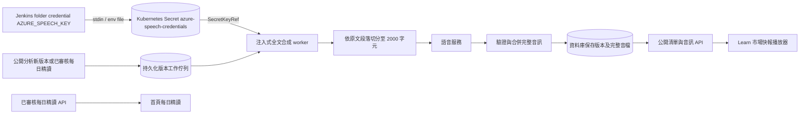
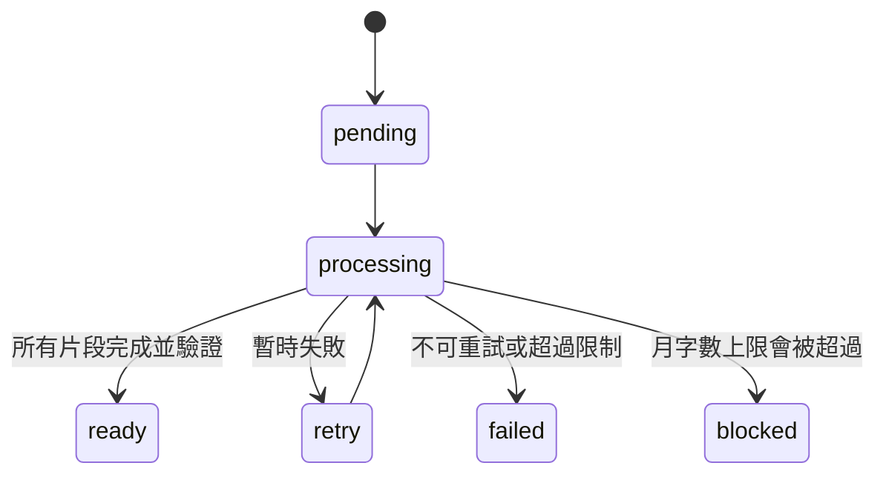

# 市場快報語音（準備中）

市場語音唯讀 API 現已接入服務，Learn 頁會列出已完成的語音並播放資料庫中的完整音檔。版本佇列、Azure Speech REST provider、全文分段/MP3 合併及月字數預留閘門已實作並測試；正式環境透過 Jenkins folder credential `AZURE_SPEECH_KEY` 安全建立 Kubernetes Secret，再由 deployment 的 SecretKeyRef 注入。`MARKET_AUDIO_AZURE_ENABLED`、`MARKET_AUDIO_AUTOGEN_ENABLED` 預設仍關閉，月字數上限為 0；不會因部署 credential 而啟動自動合成。

## 預定資料流程

## 接線與成本控制實作補充

1. 確認用戶提供的總經評論是完整版本，而不是只轉換新增段落。新分析版及已審核每日精讀會依版本入持久化佇列；worker 對完整來源文字合成，完成後寫入完整音檔。版本 id 去重，內容雜湊不同則拒絕覆寫。
2. 先以測試固定分段不遺漏文字、百分比與小數不能在小數點切開，再實作分段。
3. Azure 資源 `ty-multiverse-speech-f0` 位於 `eastus`、F0；語音目錄選中「Xiaoyu Dragon HD Flash Latest」，voice 為 `zh-CN-Xiaoyu:DragonHDFlashLatestNeural`。Microsoft 語音目錄將此 voice 類別列為 Neural HD Flash。官方 F0 價格頁只將每月 50 萬字元免費列在 `Neural` 項下，沒有明文證實 HD Flash 可用同一免費額度；PAYG 價格頁把 `Neural/Neural HD Flash` 列為按百萬字元計價，但公開美元價格顯示為 `$-`，需依 Azure 訂閱區域/幣別或實際帳單確認費率。不可把 50 萬免費字元視為 HD Flash entitlement，也不得把本地字元 cap 宣稱為美元硬上限。Azure Portal 當前網路設定為「Selected networks」，IPv4 allowlist 僅有 OKE SSH 節點出口 `140.245.44.81`；OKE SSH 實測出口亦為同一 IP。
4. 官方 TTS REST 支援依資源區域選 regional endpoint；此資源使用 `https://eastus.tts.speech.microsoft.com/cognitiveservices/v1`、`Ocp-Apim-Subscription-Key`、SSML 和 MP3 output。公開 Selected Networks/IP allowlist 模式使用此 endpoint，不需 custom domain；Microsoft 的 custom domain 指引是 Private Endpoint/Private Link 情境，若後續改用私有端點必須改 endpoint/DNS。此為依目前公網 IP allowlist 架構的選擇，端到端仍待 dry-run 驗證。
5. key 只由 `AZURE_SPEECH_KEY` 注入，region 由環境設定。provider 分段完整來源文字，使用 FFmpeg concat demuxer stream-copy 合併 MP3，而非直接串接 MP3 bytes；每個請求間隔保守 3.1 秒，避免超過 F0 每分鐘 20 個 synthesis request 的公開限制。單元測試用 FFmpeg 生成兩段獨立 MP3，合併後用 FFmpeg 完整解碼並用 ffprobe 核對時長。
5. `MARKET_AUDIO_AUTOGEN_ENABLED` 與 `MARKET_AUDIO_AZURE_ENABLED` 在 production deployment 都明確設為 `false`，`MARKET_AUDIO_MONTHLY_CHARACTER_LIMIT=0`。worker 只會在兩個旗標、key、支援區域和正數月字數上限都存在時啟動。PostgreSQL advisory lock 限制整個叢集同一時間只有一個 worker，並以 3.1 秒間隔限制 F0 request 頻率。月字數在每次外部請求前以資料庫原子預留（重試也計入），超過上限時不呼叫 provider，工作標記為 `blocked`。這是本地字元 ceiling，**不是 $1 美元硬上限**；沒有經核實的實際 rate 前不得把它換算或宣稱為美元保證。Azure 預算警報同樣不保證停止消費。

測試：後端 `poetry run python -m pytest tests/market/test_market_audio_azure.py tests/market/test_market_audio_merge.py tests/market/test_market_audio_worker.py tests/market/test_market_audio_api.py tests/market/test_market_audio_db.py tests/market/test_audio_text.py tests/market/test_daily_maya_api.py tests/market/test_daily_maya_db.py tests/market/test_daily_maya_sources.py tests/market/test_daily_maya_editorial.py tests/market/test_market_audio_deployment_secret.py -q`。部署憑證測試固定 key 必須來自 Kubernetes Secret、worker 預設關閉且 Jenkins 要透過 stdin 建立 Secret，禁止把 key 放入命令列 literal。前端以 Codex Node 24 執行 `node_modules/vitest/vitest.mjs run tests/market/dailyMayaRoutes.test.ts tests/seo/homeSeo.test.ts`（10 passed）。待正式部署與 OKE 真實 TTS 試音完成後，再記錄試音結果與音檔完整性；免費額度歸屬與實際帳單仍需 Azure 訂閱用量核實。

## 開發方法

1. 先固定分段不切壞數值、音訊必須有完整原文等測試，再做資料庫與唯讀 API；後端啟動時用既有市場資料庫 engine 初始化音訊表並註冊路由。
2. 前端只經同源 Astro server routes 讀公開清單及音訊串流，避免把後端內網位址暴露給瀏覽器；播放器使用 `preload=none`，不會自動下載或觸發 TTS 費用。
3. Azure key 由 Speech resource 取得後只存 Jenkins `vinskao` folder Secret text credential `AZURE_SPEECH_KEY`；Jenkins 綁定時不開 shell trace，以 stdin `--from-env-file=/dev/stdin` 建立 `azure-speech-credentials` Secret，deployment 只透過 SecretKeyRef 引用。禁止把值寫進原始碼、命令列參數、建置日誌或回報。Azure 網路 allowlist 僅保留 `140.245.44.81`。自動合成仍關閉；試音使用 OKE 節點上的單次請求，先核對 SKU 免費用量和費率，不以試音成功推定後續用量免費。
4. 新分析版/已審核每日精讀會排入持久化工作，worker 有重試與失敗上限，REST provider 可注入；自動 worker 預設關閉，且只允許取得 PostgreSQL leader lock 的 pod 啟動。單次試音先從 OKE 節點送短句至 regional TTS endpoint，確認 HTTP、音訊格式和完整解碼後再聽音檔。只有確認此 voice 的免費 entitlement、訂閱費率和能接受的月字數後，才評估設定自動化旗標及上限。若需 $1 美元硬上限，先以可核對的實際費率做原子美元帳本；字數 cap 不等於美元 cap。

官方核對（2026-11-03）：[HD Flash voice 清單與 API 適用性](https://learn.microsoft.com/en-us/azure/ai-services/speech-service/high-definition-voices)、[Speech TTS REST endpoint 與 request 格式](https://learn.microsoft.com/en-us/azure/ai-services/speech-service/rest-text-to-speech)、[Azure Speech 價目](https://azure.microsoft.com/en-us/pricing/details/speech/)、[Private Endpoint 的 custom-domain 規則](https://learn.microsoft.com/en-us/azure/ai-services/speech-service/speech-services-private-link)。官方價目不能驗證個別 Azure resource 剩餘免費額度或實際帳單；Speech Studio 已顯示該 voice 選中，但尚未生成音訊。
