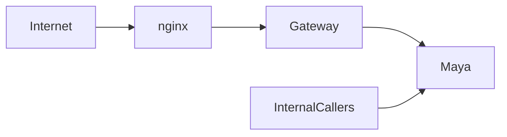

# Maya ingress through Gateway

Production switched on 2026-11-13. Public URLs stay unchanged. Legacy ingress manifests are owned by `ty-multiverse-gateway/k8s/maya-ingress.yaml`; new-domain rules stay in `peoplesystem-terraform-oke/tymultiverse-domain/mirror-ingress.yaml`. No ingress backend points directly to Maya.

## ????

Preserve ingress identity, TLS, upload and timeout annotations; update service backend in place after server dry-run. Cross-repo acceptance tests and rollback instructions: `ty-multiverse-gateway/docs/routing/MAYA_PHASE2_RESULT.md`. Public GET checks passed on both domains; protected portfolio stays 401. Large uploads, long responses and authenticated schedule writes remain untested. No application credentials changed.
