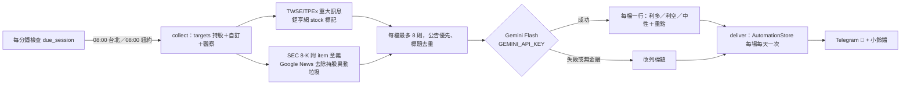

# 盤前公告與新聞摘要（每日兩次）

`maya_sawa/services/news_digest.py`：持股、自訂標的、AI 觀察清單的公司公告與新聞，每天兩次整理成一則 Telegram（📢）並存到小鈴鐺。
總經公布（央行決策、CPI、非農）走即時通道，見 [MACRO_RELEASES.md](MACRO_RELEASES.md)。

| 場次 | 時間 | 範圍 | 來源 |
|---|---|---|---|
| 台股盤前 | 平日 08:00 台北 | 4 碼台股 | 證交所／櫃買中心「每日重大訊息」OpenAPI、鉅亨網個股新聞 |
| 美股盤前 | 平日 08:00 紐約（台北冬令 21:00／夏令 20:00）| 美股與其他海外標的（例如 6857-JP，用公司名稱搜新聞）| SEC EDGAR 8-K（data.sec.gov）、Google News RSS |

兩場各看過去 24 小時，市場不重疊，所以不會重複。

## 規則與開發方法
- Gemini 只根據給它的公告與新聞寫摘要，不推測股價、不給買賣建議（`build_prompt`）。模型可用 `NEWS_DIGEST_GEMINI_MODEL` 改，預設 `gemini-2.5-flash`。
- SEC 拒絕瀏覽器樣式的 User-Agent，用 `SEC_USER_AGENT`（預設 `maya-sawa research bot`，不帶個人 email）。每次請求間隔 0.2 秒。
- 沒有新資料也會送一則「沒有新公告或新聞」，讓你知道排程有跑。
- 同一個 pod 每場只收集一次（不會在 15 分鐘時段內重複叫 Gemini）；多 pod 由 `news-digest:{tw|us}` + 當地日期去重。
- 解析器都是純函式並有測試：`tests/market/test_news_digest.py`（真實欄位名，例如證交所的「主旨 」有尾端空白、民國日期）。
- AI 排程的深度解讀不變；之後可以改讓排程讀這份摘要，而不是自己搜尋。

## 經濟數據預告
每則摘要最上面先列「📅 未來 24 小時經濟數據（台北時間）」，來源是 `maya_sawa_macro_events`（FRED 公布日期＋Finance Calendar 預期值，`market_macro.py` 寫入）。
台北 08:00 那則就會預告當晚 20:30／21:30 的美國數據；同一筆數據兩個來源都有時只列一次，優先用有預期值的那筆（`upcoming_events`）。
限制：行事曆只涵蓋 `FRED_RELEASES` 與 Finance Calendar 篩出的項目；Finance Calendar 失效（401）或 FRED 額度用完時可能漏列，例如 GDP、PCE。
