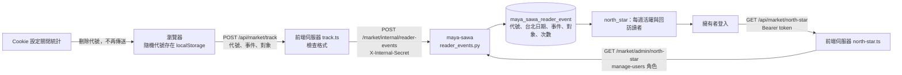

# 北極星指標的量測：每週回訪的研究讀者數

2026-11-10。指標的定義與為什麼選它，見前端的 [NORTH_STAR.md](../../ty-multiverse-frontend/docs/NORTH_STAR.md)。這份文件記錄後端怎麼收事件、怎麼算。

## 定義

- **讀者**：瀏覽器自己產生的一組隨機代號（UUID），存在該瀏覽器的 localStorage。沒有帳號，也不是 Keycloak 的 `sub`。
- **閱讀事件**：`research_open`（開啟個股研究分頁）、`analysis_open`（開啟 AI 分析分頁）、`claims_open`（展開一份報告的主張）。
- **次要事件**：`hero_search`（用了首頁搜尋，不含輸入的文字）、`topic_pick`（點了研究主題）。只計次數，不算閱讀。
- **一週**：台北時間週一到週日。
- **活躍讀者**：該週至少有一次閱讀事件的讀者數。
- **回訪讀者（北極星）**：該週活躍，而且在該週開始前的 28 天內也有閱讀事件的讀者數。同一週內讀兩次不算回訪。

## 流程

## 存什麼、不存什麼

資料表 `maya_sawa_reader_event` 只有：`visitor`（隨機代號）、`day`（台北日期）、`event`、`target`（股票代號或報告編號，最長 80 字）、`count`。

不存 IP 位址、瀏覽器資訊、帳號、頁面網址、搜尋文字。前端伺服器轉送時也不帶這些。`tests/market/test_reader_events.py` 會檢查欄位清單，加欄位前先改測試並更新隱私權說明。

## 負載控制

資料庫限制在 100m CPU，所以：

- 同一位讀者、同一天、同一事件、同一對象只有一列，重複發生只把 `count` 加一。
- 一位讀者一天最多新增 200 列（`DAILY_ROW_LIMIT`），超過的事件直接丟棄並回 `recorded: false`。
- 前端每次載入頁面，同一個（事件、對象）只送一次。
- 對外沒有直接寫入的端點：瀏覽器只能打前端的 `/api/market/track`，由前端伺服器帶內部密鑰轉送。
- `north_star` 只讀「查詢週數 × 7 ＋ 28」天內的列，在 Python 裡彙總，最多 26 週。

## 端點

| 方法與路徑 | 誰能用 | 說明 |
|---|---|---|
| `POST /market/internal/reader-events` | 前端伺服器（`X-Internal-Secret`） | 內容：`visitor`、`event`、`target`（可省略）。格式不合回 422 |
| `GET /market/admin/north-star?weeks=8` | 擁有者（`manage-users`） | 回傳各週 `weekStart`、`weekEnd`、`activeReaders`、`returningReaders`、`events`，最新一週在前 |

憑證沿用既有的 `MARKET_INTERNAL_SECRET`，沒有新增金鑰。資料表在服務啟動時由 `create_all` 建立，不需要手動執行 SQL。

## 開發方法

1. 先把定義寫成測試（`tests/market/test_reader_events.py`）：回訪要看前 28 天、同一週讀兩次不算、只搜尋不算讀者、週界線在台北午夜、重複只加次數、每日上限、欄位清單、內部密鑰與擁有者權限。測試先因模組不存在而失敗。
2. 資料庫模組照 `user_activity_db.py` 的寫法（SQLAlchemy、同一個 engine、SQLite 可測），API 測試照 `tests/security/test_admin_users.py`（自建 `FastAPI()`、覆寫權限相依、SQLite）。
3. 日期用台北日期字串存，週界線就不受資料庫時區影響，SQLite 與 PostgreSQL 行為一致。
4. 先部署後端再部署前端：前端先上線的話，事件會打到不存在的端點而被靜默丟棄，不影響頁面。
5. 上線後檢查：以擁有者登入首頁，「產品運作」區會顯示本週回訪與活躍讀者數；或直接呼叫 `GET /market/admin/north-star`。

執行：`poetry run python -m pytest tests/market/test_reader_events.py -q`

## 已知限制

- 同一個人換瀏覽器、清除網站資料或用無痕視窗，會被算成不同讀者。
- 2026-11-10 之前按過「知道了」的瀏覽器，儲存的偏好是統計關閉（當時統計尚未使用），這些讀者不會被計入，除非他們到 Cookie 設定重新開啟。
- 擁有者自己的瀏覽也會計入，目前沒有排除。
- 沒有防灌水機制，只有格式檢查與每日列數上限。
