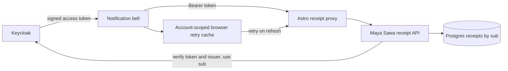
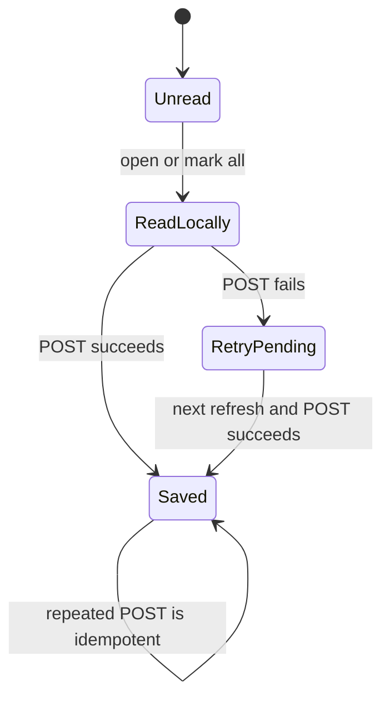

# Notification read receipts

Routine messages are stored in `maya_sawa_market_notification`. Keycloak remains the identity provider; the application stores each read receipt in `maya_sawa_notification_receipt`, keyed by the verified token's **subject (`sub`, the stable Keycloak user ID)** and the notification ID. This table is application-owned per-user state, not a complete user profile or authorization directory. The source search found no general application user table in the inspected backend and Maya Sawa models; live database inventory has not been verified.

## 開發方法

1. Confirmed the old bell stored read IDs only in `localStorage`. Added failing database and API tests for persistence, separate identities and authentication before implementing the receipt store.
2. Use the validated Keycloak `sub`, never a client-provided username, to address rows. The issuer is checked by `require_authenticated` (the backend accepts exactly one issuer) but is **not part of the key**: it is a URL that changed with the 2026-10-31 domain move and may change again, which would have orphaned every user's receipts. The composite primary key makes repeated writes idempotent. Schema creation follows the existing notification database's SQLAlchemy `create_all` startup convention. No credentials are stored in receipts; database and Keycloak credentials come from existing service configuration.
   **Cleanup (added 2026-11-03):** (a) when the notification table prunes old rows, the `routine:<id>` receipts that point at them are deleted in the same transaction; (b) each user keeps at most the newest `RECEIPTS_PER_USER` (1000, never below the 500 notifications kept) receipts, which also bounds `diary:` receipts that cannot be matched to a row here.
3. The authenticated bell loads server receipts and keeps an account-scoped browser cache for failed writes; it retries on a later refresh. Signed-out browsing continues using its existing local-only receipts. Legacy browser receipts are not automatically imported because the old shared `owner` cache cannot establish which account read them; existing notifications may therefore need to be marked read once after deployment.
4. Roll out the backend and verify its table creation and authenticated read/write on a baseline environment before deploying the frontend. Confirm logout/login and a second device, as well as a different account, before production use. This change has not been deployed or verified against a live Postgres database. For similar per-user state, use verified stable identity claims, test account isolation and retries, and document migration of pre-existing client state.

Tests: `poetry run python -m pytest tests/market/test_market_notifications.py -q` in Maya Sawa; bundled Node `node_modules/vitest/vitest.mjs run tests/notifications` in the frontend. SQLite exercises database behavior; Postgres deployment, table privileges, browser and cross-device verification remain open.

**Rollout note:** the primary key changed from (issuer, subject, notification) to (subject, notification) before anything was deployed. `create_all` never alters an existing table, so if the old-shaped `maya_sawa_notification_receipt` was ever created anywhere (a dev database), drop it before deploying; production has none. Added tests: `test_receipts_are_keyed_on_the_user_id_only_so_an_issuer_change_cannot_orphan_them`, `test_pruning_a_notification_also_removes_the_receipts_that_point_at_it`, `test_a_user_keeps_at_most_the_newest_receipts` (red before the change, 12 passed after).
