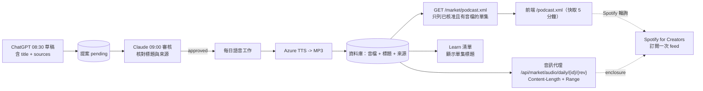

# Podcast RSS：每日市場精讀 → Spotify（2026-11-09）

Spotify **沒有**可以上傳或發佈單集的公開 API：Web API 的 Podcast 端點只能搜尋、追蹤與讀取，Spotify 開發者支援也回覆沒有開放第三方上傳的計畫。所以不是「上傳」，而是**我們公開一份 RSS feed，Spotify 訂閱一次後自己輪詢**；每天核准的精讀與語音完成後，新單集就自動出現在 feed 裡。

Feed：`https://tymultiverse.cc/podcast.xml`（前端路由代理後端 `GET /market/podcast.xml`）。

## 每集內容

| RSS 欄位 | 來源 |
|---|---|
| `title` | 提案的 `title`（草稿排程產生、審核排程核對）；舊稿沒有標題時用「每日市場精讀｜YYYY/MM/DD」 |
| `description`（show notes） | 逐字稿全文 + 「來源」清單 + 免責聲明；來源由內部引用轉成可讀文字，例如 `stock:2330:2` → 「TY Multiverse 個股分析 2330（第 2 版）」，HTTPS 網址原樣列出 |
| `enclosure` | `https://tymultiverse.cc/api/market/audio/daily/{id}/{revision}`，`length` 為 MP3 位元組數，`type=audio/mpeg` |
| `guid` | 提案 id（`isPermaLink=false`），不會因重製音檔而變 |
| `pubDate` | 音檔建立時間 |

頻道資訊在 `config/podcast.json`（名稱「Birch Investments 每日市場精讀」、語言 `zh-tw`、分類 Business > Investing、`explicit=false`、擁有者 Email）。**擁有者 Email 會公開寫在 feed 裡**，Spotify 驗證碼也寄到這個信箱，所以用網站信箱，不用個人 Gmail。封面 `ty-multiverse-frontend/public/podcast-cover.jpg`（3000x3000）。

## 標題規則

`POST /market/daily-maya/proposals` 的 `title`：選填（過渡期，讓還沒更新提示的排程不會壞），純文字、單行、1–120 字，不含 `#*`<>[]` 或換行；缺少時補日期預設標題。草稿與審核提示都要求標題，**確認排程提示已更新並穩定後，再把它改成必填**。

## 開發方法

1. 先查實：Spotify 無上傳 API，改走 RSS 輪詢。同類串接（Apple Podcasts、YouTube Music）同樣是提交一次 RSS。
2. 先寫測試再實作（紅 -> 綠）：標題欄位與舊表格就地升級、標題規則、RSS 必要欄位與跳脫、來源可讀化、只列「已核准且有音檔」的單集、路由不把錯誤頁當成 feed。
3. 舊資料庫表以 `ALTER TABLE ... ADD COLUMN` 就地升級（`create_all` 不會改既有表），舊稿標題為 `NULL`，輸出時才補預設標題。
4. 公開資訊要使用者確認：頻道名稱、擁有者 Email（會公開）、封面、簡介與免責聲明。
5. 部署後驗證順序：`/podcast.xml` 回 200 與 `application/rss+xml` -> 用 RSS 驗證工具檢查 -> 單集音檔 `Content-Length` 與 `Range` 正常 -> 才到 Spotify for Creators 提交 feed（需要使用者本人登入、接受條款、貼上寄到擁有者信箱的 8 位驗證碼）。
6. 之後每集不需要任何動作；若 Spotify 沒出現新單集，先看 feed 是否列出該集（核准 + 音檔完成），再看 Spotify for Creators 的 feed 狀態。

## 測試

後端：`poetry run python -m pytest tests/market/test_daily_maya_title.py tests/market/test_podcast_feed.py tests/market/test_podcast_api.py -q`。前端：`tests/market/podcastFeedRoute.test.ts`、`tests/learn/marketAudioPresentation.test.ts`。

## 已知缺口

- Spotify 輪詢頻率、單集出現的延遲，官方說明沒有寫明；實際以第一次提交後的觀察為準。
- AI 合成語音在 Spotify 的標示規範沒有逐條核對；簡介與封面已註明「AI 合成語音」。
- 首頁（`index.astro`）的每日精讀區塊尚未顯示單集標題，只有 Learn 清單改了。
- 音檔代理一次把整個 MP3 讀進記憶體再回傳；一天一檔約 1 MB 沒問題，單集變長或變多時要改成串流。
