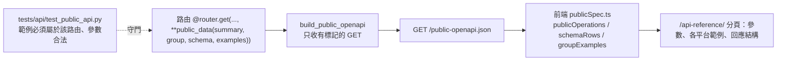

# 公開資料 API（網站「API」分頁）

網站導覽列「關於」右邊的「API」分頁（`/api-reference/`）列出任何人都能呼叫的**市場資料**端點。清單不是手寫的，
前端直接讀 `GET /maya-sawa/public-openapi.json`，所以不會和實際部署的端點有出入。

## 怎麼公開一個新的 API（不用動網站）

在路由的裝飾器加一行，網站的 API 分頁會自己出現它，前端不用改：

```python
from ..core.public_api import public_data

@router.get("/dashboard/foo/{code}", **public_data("中文說明", "分組名稱"))
async def get_foo(code: str): ...
```

- 分組名稱就是頁面上的標題；沒出現過的名稱會自動變成新的一組。
- 沒有加標記的路由永遠不會公開。FastAPI 內建的 `/openapi.json` 列出全部 100 多個端點（含內部、管理與 agent key 的路由），公開頁面不用它，
  改讀 `GET /maya-sawa/public-openapi.json`（只含有標記的 GET，不含請求內容與資料結構）。
- `tests/api/test_public_api.py` 在每次測試時檢查所有有標記的路由：必須是 GET、沒有登入／agent key／內部密鑰的依賴（含在函式裡直接讀標頭的情況）、
  有中文說明；持股、用量、通知、上傳、搜尋等都不能被標記。標錯了測試會失敗。

## 認證現況（Python 服務）

| 類型 | 怎麼驗證 | 例子 |
|---|---|---|
| 公開唯讀 | 無 | `/market/dashboard`、`/market/dashboard/history/{code}`、`/market/reports`、`/market/watch`（即本頁清單） |
| 擁有者 | Keycloak JWT + `manage-users` 角色 | `/market/portfolio`、`/market/usage`、`/market/notifications`、`POST /market/reports`、`/market/reports/web` |
| 排程 agent | `X-Market-Agent-Key`（雲端環境的代理自動加；後端只存 SHA-256） | `PUT …/analysis/{code}`、`POST /market/notify`、`/market/watch`、`/market/routine-usage`、`/market/reports/pending` |
| 內部 | `require_internal_secret` | `/market/internal/*` |

需要 SSO token 的端點無法在頁面上直接呼叫，頁面註明「請聯繫網站擁有者」。

## Spring Boot（ty-multiverse-backend）

不加 swagger：它的公開端點是人物、武器、圖庫與 AI 用量統計，都不是市場資料。

## 已知但不在這次範圍的未驗證端點

探測時發現下列 GET 不需要任何驗證：`/qa/chat-users`、`/qa/chat-history/{user_id}`（對話紀錄）、`/maya-v2/conversations/`、
`/maya-v2/ai-models/`、`/paprika/articles`（回應 560 KB）。其中對話紀錄與使用者名單是否該公開，需要擁有者決定。


## 回應結構（schema）與各平台合法查詢範例

`public_data` 另有兩個選填參數，網站 API 分頁會顯示：

```python
@router.get("/dashboard/overseas/{code}",
            **public_data("說明", "行情與標的", schema=public_schemas.OVERSEAS, examples=public_schemas.OVERSEAS_EXAMPLES))
```

- `schema`：200 回應的 JSON Schema（行內，不用 `$ref`、不產生 `components`）。頁面把它攤平成「欄位／型別／說明」表（`points[].date` 這種路徑）。
- `examples`：`{venue, title, path}` 清單，頁面依 `venue` 分組並產生可直接貼上的 `curl`。
- 內容集中在 `maya_sawa/core/public_schemas.py`，欄位依正式站實際回應整理。目前已有 schema＋範例的路由：`history`、`fundamentals`、`overseas`、`analysis`；其他公開路由尚未補 schema。

| 平台 | 代號格式 | 合法範例 |
|---|---|---|
| 台股 | 4 碼數字 | `/market/dashboard/history/2330?start=2026-10-01&end=2026-10-31`、`/market/dashboard/fundamentals/2330` |
| IBKR 美股／日股 | 代號＋`market=US\|JP\|KR\|HK` | `/market/dashboard/overseas/LITE?market=US`、`/market/dashboard/overseas/6857?market=JP` |
| Binance | 幣別代號（`BTC`、`ETH`，不是 `BTCUSDT`）＋`market=CRYPTO` | `/market/dashboard/overseas/BTC?market=CRYPTO` |



## 開發方法

1. 先到正式站打公開端點，取得真實回應，再寫 schema；不憑程式碼猜欄位（Binance 的代號是 `BTC` 而不是 `BTCUSDT`，就是這樣發現的）。
2. 測試先行：`tests/api/test_public_api.py` 檢查每個範例都落在對應路由、query 參數有宣告、`market` 值合法；測試不呼叫 handler（避免連資料庫或官方來源）。
3. 前端把「攤平 schema」「依平台分組」「組 curl」寫成純函式並測試（`tests/api/publicSpec.test.ts`），頁面只負責畫。
