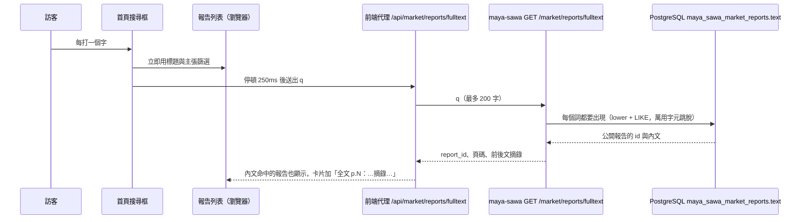

# 研究報告全文搜尋（2026-11-10）

首頁搜尋框原本只比對瀏覽器手上的資料：報告標題、發布者、網址與已萃取的主張。只出現在報告內文的字（例如某頁提到的技術名詞）找不到。現在每次輸入都會同時查報告全文。

## 規則

- **只搜公開報告**，排除 `failed`、`digest`、`archived`；端點不需登入，不回傳 PDF。
- **每個詞都要出現**（空白分隔，最多 8 個詞，不分大小寫）；`%`、`_` 當一般字元。
- 回傳每份報告第一個命中處的頁碼（依內文的 `=====PAGE n=====` 標記）與前後約 160 字摘錄。
- 這是關鍵字比對，不是語意搜尋。既有的 `GET /market/reports/search` 用向量（需要 embedding 額度），兩者分開。
- 前端只把結果用來「多顯示」列表裡已有的報告；伺服器失敗時，標題與主張的本機搜尋照常運作。

## 開發方法

1. 先寫失敗測試：`tests/market/reports/test_report_fulltext.py`（內文才有的字找得到、每個詞都要中、私人報告不出現、萬用字元不生效、長度上限）；前端 `tests/market/reportFulltext.test.ts`（停頓後才送、舊回應丟棄、清空即清除、失敗不影響本機搜尋）。
2. 實作：`MarketReportsDatabase.search_text`、`fulltext_reports` 路由（必須宣告在 `/{report_id}` 之前）；前端 `src/scripts/market/reportFulltext.ts`、代理 `src/pages/api/market/reports/fulltext.ts`、`filterMarketReports` 第四個參數。
3. **沒有加索引**：目前是循序掃描 `text` 欄。資料庫 CPU 很小，報告量變大、查詢變慢時再評估 `pg_trgm` GIN 索引（中文用 `tsvector` 需要斷詞外掛，不適用）。
