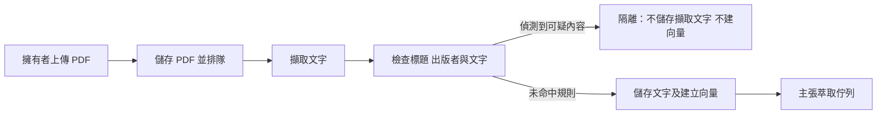
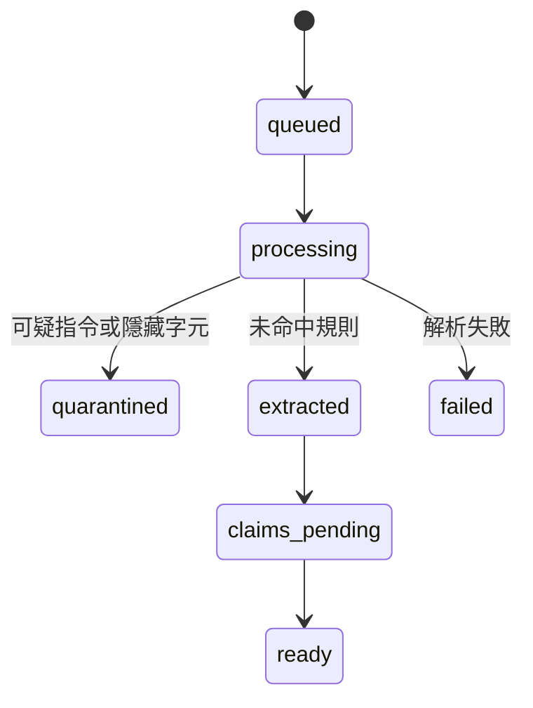

# PDF 報告安全審查

## 開發方法

1. 先測試中英文指令覆寫、機密外洩、不可見字元、正常財報文字和惡意標題，再加入規則檢查。命中後維持原始 PDF，記錄安全狀態及不含原文的原因，不保存抽取文字、不向量化、不送往待萃取佇列。
2. 此規則只是初步篩檢，不是安全證明；改寫、多語、編碼、圖片、PDF 內嵌動作和解析器漏洞可能不被偵測，正常文件也可能誤判。PDF 解析仍在服務程序內執行，沒有防毒、隔離沙箱、OCR 或多模態分析。
3. 原本的定時萃取 agent 可以讀取文件文字並使用網路工具；規則未命中並不表示它安全。既有上傳、其他來源及已在佇列的文件不會回溯審查。應另建無工具權限的隔離萃取服務，採最小權限、結構化輸出驗證與端點權限隔離，並在部署前盤點既有待處理資料。參考 [OWASP 提示注入防禦](https://cheatsheetseries.owasp.org/cheatsheets/LLM_Prompt_Injection_Prevention_Cheat_Sheet.html)。
4. 隔離文件目前顯示「安全審查：已隔離」，尚無審核或解鎖介面；擁有者可刪除並處理原始檔後重新上傳。不要直接把隔離狀態改為可處理來繞過檢查。
5. 既有 Keycloak 與資料庫憑證沿用服務環境設定，不寫入檔案。先用本地假資料與測試執行基準，部署前以無害測試文件驗證狀態及不進入排程；沒有自動啟用新的雲端憑證或排程。

測試：Maya Sawa 執行 `poetry run python -m pytest tests/test_market_reports.py -q`；前端使用 Codex Node 執行 `node_modules/vitest/vitest.mjs run tests/market/reports.test.ts`。尚未測試正式資料庫、正式 PDF 或瀏覽器，也未部署。未來應加入真實良性樣本量測誤判率及獨立的無工具權限審查流程。
