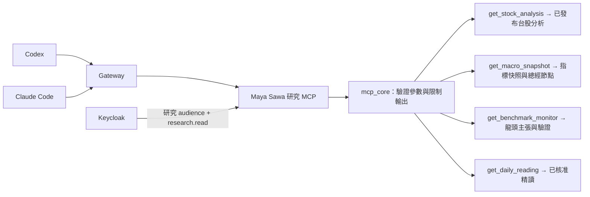

# 市場研究 MCP

Codex 與 Claude Code 可透過研究 MCP 查詢 Maya Sawa 已發布的市場研究。工具共用唯讀權限 `research.read`。

- MCP 端點：`https://tymultiverse.cc/maya-sawa/market/research/mcp`
- OAuth 資源資訊：`https://tymultiverse.cc/maya-sawa/market/research/.well-known/oauth-protected-resource`
- 網站入口：[API 文件 → 市場研究 MCP](https://tymultiverse.cc/api-reference/#research-mcp)

| 工具 | 參數 | 回傳及公開資料來源 |
|---|---|---|
| `get_stock_analysis` | `market="TW"`、`code`（如 `2330`） | 台股最新發布版本，含 `analysisId`、`analysisUrl`。引用時用 ID 核對 `GET /market/dashboard/analysis/{code}`。 |
| `get_macro_snapshot` | 選填 `series`，可用 `taiex_bias`、`valuation`、`csp`、`leverage`、指標代碼或節點 ID | 最新指標值與邏輯鏈判讀，沿用 `GET /market/dashboard/macro` 和 `GET /market/dashboard/macro/nodes`。完整指標歷史可由公開 API 查詢。 |
| `get_benchmark_monitor` | 選填龍頭 `code`（如 `2330`） | 年報、已審核主張與驗證結果，沿用 `GET /market/benchmark/monitor` 的龍頭資料。 |
| `get_daily_reading` | 選填台北日期 `date`（`YYYY-MM-DD`），預設最新 | 已核准的標題、日期、閱讀版及來源，舊稿可回退到朗讀稿文字。沿用 `GET /market/daily-maya` 的已核准資料。 |

工具回傳 `structuredContent` 與內容相同的文字 JSON。查無資料時回 `status: not_found`，參數錯誤或服務故障時回 `isError`。每項工具的兩份內容合計最多 24,000 UTF-8 bytes（以序列化後的工具結果計算）。超過時回 `truncated: true`、原結果預覽及縮小查詢或取得全文的提示。

## 加入 MCP

Claude Code 可從 repo 根目錄的 `.mcp.json` 發現端點。以下指令在本機加入既有的公開 OAuth client，新增後從 `/mcp` 完成登入。若 Keycloak 為 Claude Code 預先登記了固定回呼，加入時用 `--callback-port` 指定同一個連接埠。

```powershell
claude mcp add --transport http --client-id ty-research-mcp ty-research https://tymultiverse.cc/maya-sawa/market/research/mcp
```

Codex 可在加入時跟隨終端提示登入，之後可用 `codex mcp login ty-research` 重新登入。

```powershell
codex mcp add ty-research --url https://tymultiverse.cc/maya-sawa/market/research/mcp --oauth-client-id ty-research-mcp
```

CLI 參數可參考 [Claude Code MCP 文件](https://code.claude.com/docs/en/mcp#use-pre-configured-oauth-credentials) 及本機 `codex mcp add --help`。



## 開發方法

1. 用既有公開分析查詢與 `market_ai_analysis_db.read` 取得相同版本。先限制台股代碼，避免把海外標的套用台股代碼規則。
2. 沿用 Birch 的無狀態 HTTP 傳輸模式，以 JSON 回應 POST。已驗證的 GET 回 405。獨立研究端點使用 `research.read` scope 和端點完整網址作為 audience，研究查詢不需 owner 角色。
3. 先在測試環境用 `RESEARCH_MCP_RESOURCE_URL` 指定實際公開的完整 MCP 網址，以 `/mcp` 結尾。為 Keycloak 專用 OAuth client 設定 Authorization Code 與 PKCE S256，配置唯讀 scope 及研究端點 audience mapper。公開端點、資源 metadata 與 token audience 必須相符。依 Codex 和 Claude Code 實際顯示的回呼 URI 設定精確白名單。維持研究 client 與一般網站及 Birch client 的權限隔離。
4. 部署後從 Gateway 檢查未登入請求的 401、`WWW-Authenticate` 與公開 OAuth metadata。分別在兩個 Agent 登入並查 `TW / 2330`，核對版本和更新時間與公開 API 一致，再驗證研究 token 被 Birch 和一般寫入端點拒絕。
5. （2026-11-19）新增工具時先寫工具發現、成功、查無、參數驗證及大小驗收。沿用公開讀取函式，Benchmark 以欄位清單挑出龍頭研究，精讀依日期直接查已核准資料。這讓 MCP 可沿用網站的計算與發布版本。
6. （2026-11-19）由 `mcp_core` 在建立 JSON-RPC 回應前計算工具結果的 UTF-8 大小，涵蓋文字 JSON 的跳脫字元。唯讀工具註冊沿用既有 Keycloak client、audience 與 scope。
7. （2026-11-19）先在本機用固定資料及簽章 token 驗證，再由部署人員核對正式環境的四項工具、公開 API 版次及兩個 CLI 的登入。階段 1 上線後觀察兩週，再評估後續工具。

## 測試

```powershell
poetry run python -m pytest tests/test_research_mcp.py tests/test_research_mcp_tools.py tests/test_mcp_core.py tests/market/test_daily_maya_db.py tests/market/test_daily_maya_api.py tests/market/test_benchmark_monitor_api.py tests/social/test_publisher_mcp.py tests/api/test_public_api.py -q
```

測試使用簽章 token 與分析 fixture 驗證 scope、audience、端點隔離、工具發現、代碼驗證、查無資料和成功查詢。真實 Keycloak 設定、Gateway 上線與兩個 Agent 的登入是部署驗收項目。
