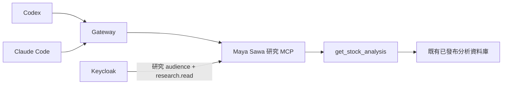

# 市場研究 MCP

Codex 與 Claude Code 可分別登入同一個研究 MCP，查詢台股最新已發布的 AI 分析。工具只讀取現有資料。

- MCP 端點：`https://tymultiverse.cc/maya-sawa/market/research/mcp`
- OAuth 資源資訊：`https://tymultiverse.cc/maya-sawa/market/research/.well-known/oauth-protected-resource`
- 工具：`get_stock_analysis(market="TW", code="2330")`。回傳 `status`、市場與代碼。查到時另有 `analysis`（含 revision、model、content、updatedAt）、`analysisId` 和 `analysisUrl`。查無則回傳 `not_found`。
- `analysisUrl` 指向既有公開分析 API。該網址會顯示最新版本及可用的歷史版本，引用時搭配 `analysisId` 核對版本。



## 開發方法

1. 用既有公開分析查詢與 `market_ai_analysis_db.read` 取得相同版本。先限制台股代碼，避免把海外標的套用台股代碼規則。
2. 沿用 Birch 的無狀態 HTTP 傳輸模式，以 JSON 回應 POST。已驗證的 GET 回 405。獨立研究端點使用 `research.read` scope 和端點完整網址作為 audience，研究查詢不需 owner 角色。
3. 先在測試環境用 `RESEARCH_MCP_RESOURCE_URL` 指定實際公開的完整 MCP 網址，以 `/mcp` 結尾。為 Keycloak 專用 OAuth client 設定 Authorization Code 與 PKCE S256，配置唯讀 scope 及研究端點 audience mapper。公開端點、資源 metadata 與 token audience 必須相符。依 Codex 和 Claude Code 實際顯示的回呼 URI 設定精確白名單。維持研究 client 與一般網站及 Birch client 的權限隔離。
4. 部署後從 Gateway 檢查未登入請求的 401、`WWW-Authenticate` 與公開 OAuth metadata。分別在兩個 Agent 登入並查 `TW / 2330`，核對版本和更新時間與公開 API 一致，再驗證研究 token 被 Birch 和一般寫入端點拒絕。

## 測試

```powershell
poetry run python -m pytest tests/test_research_mcp.py tests/social/test_publisher_auth.py tests/social/test_publisher_mcp.py tests/social/test_social_publish_queue.py tests/api/test_public_api.py -q
```

測試使用簽章 token 與分析 fixture 驗證 scope、audience、端點隔離、工具發現、代碼驗證、查無資料和成功查詢。真實 Keycloak 設定、Gateway 上線與兩個 Agent 的登入是部署驗收項目。
