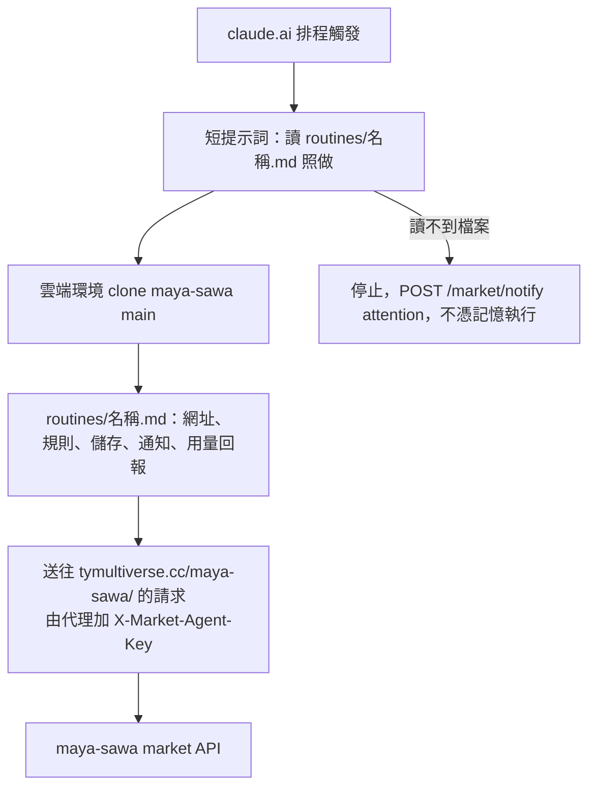

# 排程提示詞放在 repo（routines/*.md）

2026-11-02 起，Default 環境的八個排程把完整指示放在 `maya-sawa/routines/<名稱>.md`，排程本身的提示詞只是一段短指標：
「讀 routines/<名稱>.md，完整照做」。排程清單與時間見 [MARKET_AGENT_KEY.md](MARKET_AGENT_KEY.md)。

## 為什麼

網域改成 `tymultiverse.cc` 後，雲端環境把已棄用的 `peoplesystem.tatdvsonorth.com` 擋掉，十個排程的提示詞卻都寫死舊網址。
更新一個排程要把整份提示詞（6–7 KB）重送一次、回應又原樣回傳兩次，換網址要做十次大的編輯，也容易打錯字。
指示放進 repo 以後，換網址或改規則是一個可審查、可測試的 commit。

## 目前遷移的排程

| 指示檔 | 排程 |
|---|---|
| `market-us-macro-sonnet.md` / `market-us-macro-opus.md` | 市場 AI 分析｜美股與總經（Sonnet／Opus 輪班），週二至週六 07:30 |
| `market-taiwan-sonnet.md` / `market-taiwan-opus.md` | 市場 AI 分析｜台股收盤後（Sonnet／Opus 輪班），週五 21:15 |
| `weekly-maintenance-{backend,maya-sawa,frontend}.md` | 每週維護，各自週三／週六／週日 01:00 |
| `report-claim-extraction.md` | 市場報告｜萃取主張，每天 20:30 |

**未遷移（原因）：**
- 日記敘事：打的是 `/tymb/diary/agent`（另一個後端），而 agent key 的 network secret 路徑前綴只限 `/maya-sawa/`；要先決定它的 key 怎麼給。
- 每週技術探討文：跑在另一個環境（TY Blog Weekly），網路設定獨立。
- 審核 GPT 每週提案：2026-11-02 建立時就直接寫新網址，仍是完整提示詞。

## 開發方法

1. 先量問題：列出每個排程提示詞出現舊網域的次數與段落（兩個美股／台股組各 13–17 處，其餘 1–3 處）。
2. 先寫測試（`tests/automation/test_routine_prompts.py`）：每個遷移的排程有指示檔；指示檔不得出現舊網域（唯一例外是一句說它已棄用）；
   API 呼叫都指向 `tymultiverse.cc/maya-sawa/`；檔案不含金鑰樣式、也不教排程自己設驗證標頭；寫入類排程保留「代理加 key」說明與用量回報步驟。
   確認紅（目錄不存在）後再產生檔案。
3. 用腳本從排程當下的提示詞產生檔案（網址、「網址」段落、「network secret 送往哪個主機」一句由程式替換，不靠手打），再跑測試。
4. 推上 `main` 之後才把排程提示詞換成指標（排程是在執行時 clone `main`，順序反了會讀不到檔案）。
5. 逐個手動觸發一次，讀執行紀錄確認它讀到了檔案、API 通、通知與用量回報成功。
6. 之後改規則或網址：改 `routines/*.md`、跑測試、推 `main`，不需要再動排程。

**限制與風險：** 排程若讀不到檔案就不會做事（指標要求它停止並用 attention 通知）。指示檔在 `main`，所以改它等於改排程行為，推送前要有測試與審查。
測試：`poetry run python -m pytest tests/automation/test_routine_prompts.py -q`。
