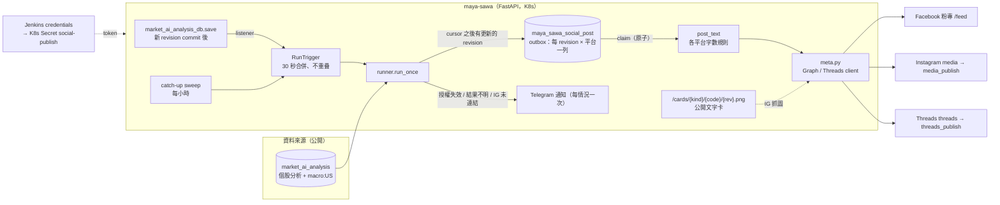
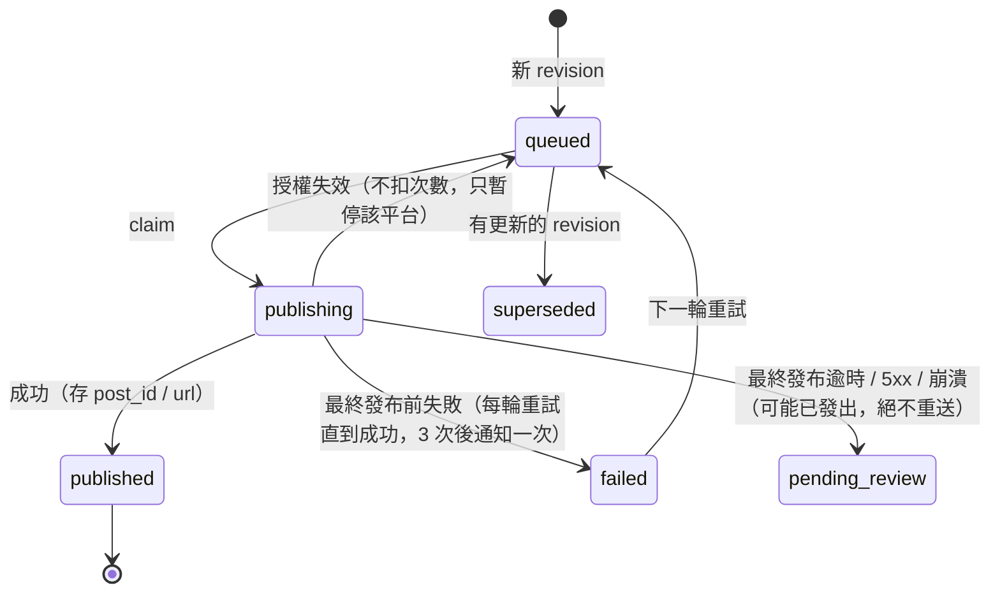

# Social publishing (Facebook Page, Instagram, Threads)

Maya Sawa itself posts every new public AI analysis revision to the Birch Investments Facebook Page, Instagram and
Threads. No ChatGPT task or Metricool is involved: the post text is the analysis verbatim, so no model is needed.
This replaces the ChatGPT/Metricool flow in [BIRCH_THREADS_PUBLISHING.md](BIRCH_THREADS_PUBLISHING.md), whose
Metricool connector could only schedule posts and never return a verified post URL.

## What gets posted, when

- **When:** as soon as an analysis is saved (2026-11-02; was Wed/Fri/Sun 21:30). `market_ai_analysis_db.save` calls its
  listeners after commit; `runner.on_analysis_saved` fires `RunTrigger`, which waits 30 s so a batch of saves goes out
  in one run, and never runs two passes at once. An hourly catch-up sweep retries `queued`/`failed` posts. Only the
  current revision of each analysis is posted; older revisions saved in between are `superseded`.
- **Sources:** the current `stock` analyses and `macro:US`, exactly what `/dashboard/analysis/{code}` serves
  publicly (`services/social/sources.py`). Never holdings, costs or private reports.
- **Coverage (2026-11-02):** every run takes the **latest** revision of every stock analysis and `macro:US` and makes
  sure it is published on every configured channel. Anything not yet posted, including analyses older than the first
  run, is queued and sent in the same run, one after another, until all are out. There is no baseline skip any more.
  `GET /social/status` returns `coverage` (per latest analysis, the state on each channel, `missing` if not queued yet)
  and `complete` (all published).
- **Text** (`services/social/post_text.py`): the analysis verbatim. Macro gets the title
  「總經評論｜所有個股分析共用」; a stock gets its code in front only if the first line lacks it. Over the limit
  (Threads 500, Instagram 2,200, Facebook none) the front is kept, cut at a sentence or line end, and
  「更多請至我的網站：https://tymultiverse.cc/」 is appended unless the kept text already links the site.
- **Instagram image:** IG has no text-only posts. Each post uses a 1080×1350 text card
  (`services/social/card.py`) served publicly at
  `/maya-sawa/market/publishing/cards/{stock|macro}/{code}/{revision}.png` (current revision only, else 404).
  The image uses Noto Sans TC (two OTF weights downloaded and checksum-verified in the Dockerfile).
- **Order and pacing:** oldest revision first, Facebook → Instagram → Threads, 20 seconds between posts.

## Never posting twice

Table `maya_sawa_social_post` has one row per (revision, platform):

| State | Meaning | Next |
|---|---|---|
| `queued` | waiting | claimed atomically on the next run |
| `publishing` | claimed, request in flight | → `pending_review` if stuck 30 min |
| `published` | live; `post_id` and `url` stored | never touched again |
| `failed` | failed **before** the final publish call, nothing is live | retried on every run until it is posted; one Telegram alert after 3 failures |
| `pending_review` | final publish call timed out / 5xx / crashed: the post **may** be live | never resent; Telegram alert; check the platform by hand |
| `superseded` | a newer revision replaced it before it went out | the newer revision is posted instead |

An expired or revoked token (Graph error 190/102) puts the post back in `queued` without spending an attempt, pauses
only that platform for the run, and sends one Telegram alert per episode. Posts resume on the next run after the
credential is fixed.

## Owner endpoints

- `GET /maya-sawa/market/publishing/social/status`: `enabled`, which platforms are configured, the cursor, and every
  row. Requires the `manage-users` role.
- `POST /maya-sawa/market/publishing/social/run`: run once now (only when enabled). Same role.

## Credentials (Jenkins Secret text → K8s Secret `social-publish`, all optional)

| Jenkins credential ID | Value |
|---|---|
| `SOCIAL_PUBLISH_ENABLED` | `true` to start the scheduler |
| `META_PAGE_ACCESS_TOKEN` | a long-lived **user** token (with `pages_show_list`, `pages_manage_posts`, `pages_read_engagement`, `instagram_basic`, `instagram_content_publish`) **or** a Page token. A user token is swapped each run for the Birch Investments Page's own token via `/me/accounts` (2026-11-02: Jenkins held a user token and Facebook/Instagram were silently skipped). The user token expires after ~60 days; a Page token taken from it does not |
| `THREADS_ACCESS_TOKEN` | long-lived (60-day) Threads token from the app's Threads *User Token Generator*; used once as the seed |
| `META_PAGE_ID`, `INSTAGRAM_USER_ID`, `THREADS_USER_ID` | optional overrides; by default each run looks them up from the tokens (`/me` with the Page token returns the Page and its linked `instagram_business_account`; Threads `/me` returns the user id) |

Instagram is "configured" only when the Page has a linked Instagram professional account. When a run finds the Page
token but no linked Instagram, it sends one Telegram message (not one per run) saying Instagram is being skipped and how
to link it; the message re-arms once the link exists. Revisions that went out while Instagram was skipped are not
back-filled to Instagram later. A failed Page lookup (expired token, network) is *not* reported as a missing link.
A platform without its ids/token is skipped. Threads tokens are refreshed weekly by the server and the refreshed
token is kept in `maya_sawa_social_state` (Postgres), so the Jenkins value only seeds it. Never put tokens in Git,
prompts or screenshots.

### Getting the ids and tokens (owner, once)

1. developers.facebook.com → Create app (Business). Add the use cases for Pages management, Instagram API with
   Facebook Login, and the Threads API. Development mode is enough because you are the app admin; no App Review is
   needed for your own Page and accounts.
2. Instagram must be a professional (Business/Creator) account linked to the Birch Investments Page.
3. Facebook/Instagram: in Graph API Explorer, get a user token with `pages_show_list`, `pages_read_engagement`,
   `pages_manage_posts`, `instagram_basic`, `instagram_content_publish`; exchange it for a long-lived user token
   (`/oauth/access_token?grant_type=fb_exchange_token`); `GET /me/accounts` returns the Page id and Page token;
   `GET /{page-id}?fields=instagram_business_account` returns the Instagram user id.
4. Threads: add `birch_investments` as a Threads tester and accept the invite in Threads settings; authorize with
   `threads_basic`, `threads_content_publish`; exchange for a long-lived token (`grant_type=th_exchange_token`);
   `GET https://graph.threads.net/v1.0/me?fields=id,username` returns the user id.
5. Save the six values as Jenkins Secret text credentials, then rebuild maya-sawa. Check
   `/social/status`; the first scheduled run (or `POST /social/run`) records the baseline.

## Tests

`poetry run python -m pytest tests/test_social_post_text.py tests/test_social_card.py tests/test_social_meta.py tests/test_social_runner.py tests/test_social_api.py -q`

Trigger tests: `test_a_new_analysis_revision_triggers_one_coalesced_run`, `test_a_failing_run_does_not_stop_later_triggers`,
`test_saving_an_analysis_notifies_listeners_only_for_a_new_revision`.

The Meta responses in `tests/fixtures/meta_responses.json` follow Meta's documentation. Replace them with trimmed live
captures (no tokens) after the first real run.

## 架構圖

### 單一貼文的狀態機

## 開發方法（這次串接 FB / IG / Threads 的做法，之後同類串接照做）

1. **先寫「不重發」的規則，再寫程式。** 外部平台沒有冪等鍵，所以先定義狀態（上表）與「結果不明就不重送」，再寫 `outbox.py`。重發比漏發糟。
2. **測試先行，外部服務一律注入。** `meta.py` 的 client、`runner.run_once` 的 `sources / current / publishers / notify / pause` 都由參數傳入，測試不連網；每個狀態轉換、每種錯誤（190/102、逾時、5xx）各一個測試（`tests/test_social_*.py`）。
3. **回應 fixture 先照官方文件，真實發過後換成實測。** `tests/fixtures/meta_responses.json`（去掉 token）。
4. **憑證走 Jenkins Secret text → K8s Secret，全部選填。** 沒設就略過該平台；id（Page、IG、Threads user）由 token 反查，少填兩個值。Threads 長效 token 由伺服器每週續期、存資料庫。
5. **先上線「只記基準線」再開始發。** 第一次排程只記 cursor，確認狀態端點與通知都正常後，下一輪才真的發。
6. **平台限制寫成可測的純函式。** 字數上限、截斷位置、IG 文字卡尺寸都在 `post_text.py` / `card.py`，不寫在排程裡。
7. **失敗要通知、且只通知一次。** 授權失效、結果不明、IG 未連結都發 Telegram，用 outbox 的 `alerted:*` 鍵去重，情況恢復後重新武裝。
8. **觸發改成事件驅動（2026-11-02）。** 不再靠 GPT 排程，所以改為分析一存檔就發：DB 層只提供 listener 清單（不 import 社群模組），runner 啟用時才註冊；listener 出錯不影響存檔；`RunTrigger` 先寫測試（合併、失敗後仍可再觸發）。保留每小時 sweep 補重試。
9. **覆蓋率取代基準線（2026-11-02）。** 需求改為「每個標的與總經的最新一篇都要發過」，所以拿掉第一次只記基準線的設計，每輪以全部最新 revision 為準補齊；`coverage()` 先寫測試，再接到 status。
10. **Token 類型不要假設。** 線上發現存的是 user token；先用真實錯誤回應（#100 nonexisting field）寫失敗測試，再讓 `discover_page` 兩種都吃。
11. **文件與架構圖同一個 commit。** 見工作區 `AGENTS.md`「新流程／架構要畫圖並記錄方法」。
