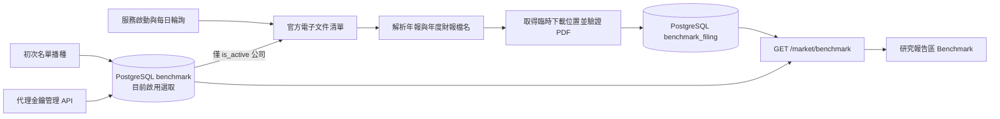
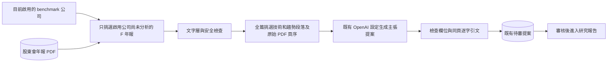
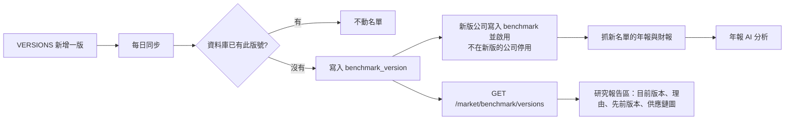
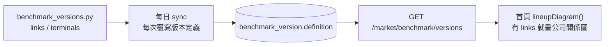
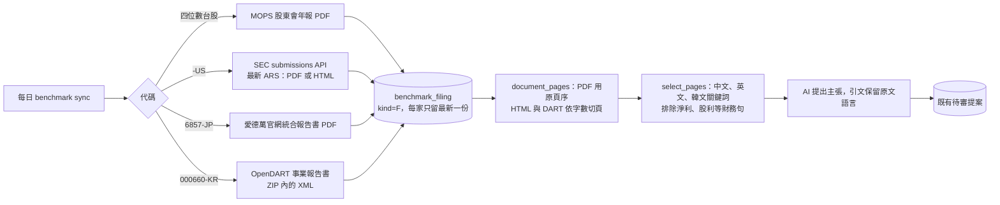

# 台灣半導體 Benchmark 與申報文件

只處理資料庫 `benchmark` 表中當下 `is_active=TRUE` 的台灣公司。名單有版本（見文末「名單版本」）：程式裡最新的版本第一次出現時套用一次，其後名單以資料庫為準，日常同步不會覆寫人工選取。每日輪詢證交所 MOPS 電子文件服務，保存中文股東會年報及年度財務報告 PDF。股東會年報依檔名的會計年度歸檔，查詢年度為隔年的股東會年度。財務報告取第四季完整合併與個體財報，排除同期間英文版與其他資料。

## 開發方法

1. 先從官方清單核對上市 2330、上櫃 6488。股東會年報走 F04，第四季中文財報走 AI1／AI3，使用官方 step 9 取得短效 PDF 路徑。這是官方網站使用的 HTTP 介面，並非公開 JSON OpenAPI。免來源金鑰，PostgreSQL 沿用部署既有連線設定。
2. 加入來源樣本的分類與連結限制測試，再實作解析。保存原始 PDF、雜湊、檔名、會計年度及可重查的官方清單位置，研究報告區只顯示中繼資料與官方入口。
3. 初次同步檢查最近三個會計年度，涵蓋跨年發布。以 PostgreSQL advisory lock 避免重複執行。每份文件獨立提交，失敗隔日重試，已存檔名不重抓。來源若原檔名不變即覆寫，須人工比對並重新匯入。
4. 發布後驗收以 PostgreSQL 的文件列與 PDF 長度確認入庫，再核對前端顯示年度與官方清單。日常同步不由訪客觸發。

測試 `python -m unittest discover -s tests/integrations -p test_tw_benchmark_filings.py`。

## 產業趨勢與技術證據分析

### 開發方法

1. 只處理股東會年報。逐頁找市場需求、技術路線和規格、試產及量產、擴產、客戶驗證、供應風險。五類章節都可提供證據，例如募資用於擴廠、ESG 中的能源與供應風險。用內容選取，避免各家公司章節格式不同造成整章漏抓。
2. 先測試金融文字排除、原頁序保留、錯頁和虛構引文拒絕。對歷史財務措辭採保守過濾，混合財務及技術資訊的句子也可能被排除。OCR、圖表及跨頁內容仍需另行處理。
3. 每次同步最多分析四份，每份最多 16,000 字的摘錄與八筆主張。使用部署原有的 OPENAI_API_KEY、OPENAI_API_BASE 和 OPENAI_DEFAULT_MODEL。只有通過安全檢查的摘錄交給模型。掃描檔、無證據和隔離檔保留原件及處理狀態。
4. 模型輸出寫入既有審核佇列，通過既有審核才套用。比對引文及原頁後，再檢查公司計畫、已完成事項和推論是否分清。既有提案不重送，暫時性錯誤留待後續同步重試。
5. 新增／更新台灣公司使用 `PUT /market/benchmark/{code}`，停用或重新選取使用 `PUT /market/benchmark/{code}/selection`，兩者均需 `X-Market-Agent-Key`。新公司需送入代碼、名稱、環節、benchmark 意義及 active 狀態。停用只停止後續抓取與 AI 分析，不刪除既有年報、報告或審核紀錄。重新啟用時，尚未分析的歷年年報會進入佇列；已處理的文件不會重複建立提案。
6. 每日同步先讀目前啟用名單，再為每家公司檢查最近三個年度。每輪最多處理四份尚未分析的股東年報；後續每日持續清空佇列。只有研究報告提案經既有審核通過後才成為正式主張。
7. 部署後先核對 benchmark.is_active、benchmark_filing 的分析狀態、待審提案與來源頁碼，再核對審核後的研究報告。測試指令為 `poetry run python -m pytest tests/integrations/test_benchmark_selection.py tests/integrations/test_benchmark_evidence.py tests/integrations/test_benchmark_analysis.py tests/integrations/test_tw_benchmark_filings.py tests/market/reports/test_claim_inbox.py tests/market/reports/test_market_reports.py -q`。

## 名單版本

名單整份換版，每版記錄選股理由。版本定義在 `maya_sawa/benchmark_versions.py` 的 `VERSIONS`，存入 `benchmark_version` 表（版號、名稱、理由、分層與流向的 JSON、採用時間）。

| 版 | 名稱 | 選法 |
|---|---|---|
| 1 | 台積電本土設備鏈觀察名單 | 依製程步驟選 16 家，設備、耗材與廠務占 9 家 |
| 2 | 台灣半導體全產業骨幹 | 11 個環節各一家龍頭加一家對照公司，共 22 家；補上記憶體、矽智財與 ASIC、測試介面、載板、專業測試 |
| 3 | 各環節只留龍頭 | 每個環節只留龍頭一家，共 12 家。Benchmark 只用股東會年報定調產業指引與景氣位置，不是買進標的，所以不放對照公司；晶圓代工拆成先進與成熟製程，因為兩者循環不同步 |
| 4 | 加入需求端與海外龍頭 | 第三版 12 家加 7 家海外龍頭，共 19 家：四家雲端服務商（各讀各的股東年報，不合併）、NVIDIA、SK 海力士（HBM，與南亞科分成兩個環節）、愛德萬（測試機台）。每家都要能從官方來源取得最新股東年報才列入 |

### 開發方法

1. 換名單就在 `VERSIONS` 末端加一版（版號加一），寫明理由、分層（圖上的每一列）、每列的環節、每個環節的公司（代碼、名稱、環節說明、角色、Benchmark 意義）與列之間的流向。不要改舊版內容，舊版是紀錄。
2. 同步時若資料庫最大版號小於程式最新版號，補寫缺少的版本列，並只套用最新一版：新版公司 upsert 並啟用，其餘公司 `is_active=FALSE`。被停用公司的年報、報告與審核紀錄都保留。
3. 版本套用只發生一次。之後用 `PUT /market/benchmark/{code}` 或 `/selection` 做的人工調整不會被每日同步改回；但人工調整不會產生新版號，要留紀錄就加版本。
4. `GET /market/benchmark` 只回目前啟用的公司；`GET /market/benchmark/versions` 由新到舊回傳所有版本，第一筆 `is_current=true`。
5. 測試 `poetry run python -m pytest tests/integrations/test_benchmark_versions.py tests/integrations/test_benchmark_selection.py -q`。

## 只留最新一份股東會年報（2026-11-10）

Benchmark 公司用來定調產業 guidance 與景氣位置，不是買入標的，所以和持股研究分開存放（`benchmark`、`benchmark_filing` 兩張表），也不需要多年財報。

- 每日同步只抓股東會年報（F）：先查今年度，查不到才查去年度，每家只取最新一份。不再抓年度財務報告（A），也不再回溯三年。先前已存的舊年度檔案保留，但不進分析佇列。
- 分析佇列只挑每家公司最新年度的年報，每輪上限由 4 份提高到 `DAILY_LIMIT = 24`，一整版名單（第三版 12 家）一天可跑完。仍使用部署既有的 OpenAI 設定。

## 第三版的圖：公司對公司的關係

第三版的定義多了 `links`（公司代號對公司代號，附說明）與 `terminals`（非公司的終點，例如終端產品）。圖的目的是說明每家公司為什麼重要，所以箭頭畫在公司之間，不再畫在層與層之間。兩家公司之間沒有往來（聯發科賣自有晶片、創意替客戶設計晶片）就分成不同環節，各自連到晶圓廠。

開發方法：名單成員仍然只在版本第一次出現時套用；版本的名稱、理由與畫法每次 sync 都以程式為準覆寫，所以修正圖不必升版。先寫測試（每家公司至少出現在一條 link、端點必須是名單內代號或 terminal），再補資料。`links` 的內容是產業常識層級的關係，尚未逐條以年報的主要客戶與供應商揭露核對。

## 第四版：海外龍頭與各自的股東年報來源（2026-11-11）

第四版在台灣供應鏈兩端加上海外龍頭：需求端的 Alphabet、Microsoft、Amazon、Meta，設計端的 NVIDIA，記憶體的 SK 海力士，後段的愛德萬。選入的條件是**每家都能從官方來源自動取得最新一份股東年報**，所以先逐家確認來源才放進名單：

| 代碼 | 公司 | 年報 | 來源 | 2026-11-11 實測 |
|---|---|---|---|---|
| GOOGL-US、META-US、MSFT-US、AMZN-US、NVDA-US | 美國五家 | 股東年報（SEC form ARS） | `data.sec.gov` submissions API 找最新 ARS | 五家都取得；Meta 的 ARS 是 HTML，其餘是 PDF |
| 6857-JP | 愛德萬 | 統合報告書（Integrated Annual Report） | 官網 `E_all_IAR{版次}.pdf`，版次年份 = 會計年度結束的那年 3 月 | 取得 IAR2026（FY2025，19.9 MB） |
| 000660-KR | SK 海力士 | 사업보고서（事業報告書） | OpenDART `list.json` + `document.xml`，用部署既有的 `OPENDART_API_KEY`（Jenkins credential） | 本機沒有金鑰，未實測；正式環境同一把金鑰已在抓 SK 海力士財報 |

美光沒有選入：SK 海力士才是 HBM 龍頭，而 OpenDART 金鑰早已設定，事業報告書抓得到。

- 程式：`maya_sawa/overseas_benchmark_filings.py`（找年報、下載、轉成頁面文字），`api/tw_benchmark.py` 的 `sync_overseas`（海外代碼不走 MOPS）。管理 API `PUT /market/benchmark/{code}` 現在也接受有年報來源的海外代碼，沒有來源的海外代碼回 422。
- HTML 年報（Meta）與 DART 沒有頁碼，依字數切頁，主張的 page 指的是切出來的頁序，不是印刷頁碼。
- 首頁圖的節點 id 原本只留數字，美股代碼會全部變成同一個節點；台股維持 `c2330`，海外改成 `cNVDA_US`。

### 開發方法

1. 先確認來源再選公司：SEC submissions API 列出六家美股的 ARS（含美光，後來改選 SK 海力士），愛德萬用 HEAD 確認 PDF，SK 海力士確認 Jenkins 已有 `OPENDART_API_KEY` 且正式環境正在使用。
2. 先寫測試：`tests/integrations/test_overseas_benchmark_filings.py`（挑最新 ARS、挑最新事業報告書並略過季報、愛德萬找最新存在的版次、沒有 DART 金鑰時略過、只有已知來源的代碼算海外 benchmark、HTML 與 DART ZIP 轉文字、英文與韓文句子的選取與財務句排除）；`test_benchmark_versions.py` 加第四版（19 家、四家 CSP 分開、每個供應鏈環節一家、每家都有連線且都有年報來源）。前端 `tests/market/benchmarkChain.test.ts` 加海外節點 id 與標題。
3. 實作後對真實來源跑一次：美國五家與愛德萬都下載成功，Meta、NVIDIA、愛德萬各選出約 13,000–16,000 字的前瞻句。
4. 部署後確認：`benchmark` 表 19 家啟用、`benchmark_filing` 出現 7 筆海外年報（SK 海力士要看 OpenDART 是否回傳）、待審提案出現海外公司的主張。
5. 測試：`poetry run python -m pytest tests/integrations -q`；前端 `node node_modules/vitest/vitest.mjs run tests/market/benchmarkChain.test.ts`。
