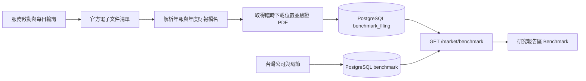
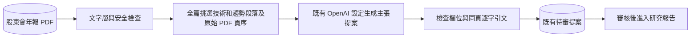

# 台灣半導體 Benchmark 與申報文件

涵蓋 Benchmark 所列的 16 家台灣上市櫃公司。每日輪詢證交所 MOPS 電子文件服務，保存中文股東會年報及年度財務報告 PDF。股東會年報依檔名的會計年度歸檔，查詢年度為隔年的股東會年度。財務報告取第四季完整合併與個體財報，排除同期間英文版與其他資料。

## 開發方法

1. 先從官方清單核對上市 2330、上櫃 6488。股東會年報走 F04，第四季中文財報走 AI1／AI3，使用官方 step 9 取得短效 PDF 路徑。這是官方網站使用的 HTTP 介面，並非公開 JSON OpenAPI。免來源金鑰，PostgreSQL 沿用部署既有連線設定。
2. 加入來源樣本的分類與連結限制測試，再實作解析。保存原始 PDF、雜湊、檔名、會計年度及可重查的官方清單位置，研究報告區只顯示中繼資料與官方入口。
3. 初次同步檢查最近三個會計年度，涵蓋跨年發布。以 PostgreSQL advisory lock 避免重複執行。每份文件獨立提交，失敗隔日重試，已存檔名不重抓。來源若原檔名不變即覆寫，須人工比對並重新匯入。
4. 發布後驗收以 PostgreSQL 的文件列與 PDF 長度確認入庫，再核對前端顯示年度與官方清單。日常同步不由訪客觸發。

測試 `python -m unittest discover -s tests/integrations -p test_tw_benchmark_filings.py`。

## 產業趨勢與技術證據分析

### 開發方法

1. 只處理股東會年報。逐頁找市場需求、技術路線和規格、試產及量產、擴產、客戶驗證、供應風險。五類章節都可提供證據，例如募資用於擴廠、ESG 中的能源與供應風險。用內容選取，避免各家公司章節格式不同造成整章漏抓。
2. 先測試金融文字排除、原頁序保留、錯頁和虛構引文拒絕。對歷史財務措辭採保守過濾，混合財務及技術資訊的句子也可能被排除。OCR、圖表及跨頁內容仍需另行處理。
3. 每次同步最多分析四份，每份最多 16,000 字的摘錄與八筆主張。使用部署原有的 OPENAI_API_KEY、OPENAI_API_BASE 和 OPENAI_DEFAULT_MODEL。只有通過安全檢查的摘錄交給模型。掃描檔、無證據和隔離檔保留原件及處理狀態。
4. 模型輸出寫入既有審核佇列，通過既有審核才套用。比對引文及原頁後，再檢查公司計畫、已完成事項和推論是否分清。既有提案不重送，暫時性錯誤留待後續同步重試。
5. 部署後先核對 benchmark_filing 的分析狀態、待審提案與來源頁碼，再核對審核後的研究報告。測試指令為 `poetry run python -m pytest tests/integrations/test_benchmark_evidence.py tests/integrations/test_benchmark_analysis.py tests/integrations/test_tw_benchmark_filings.py tests/market/reports/test_claim_inbox.py tests/market/reports/test_market_reports.py -q`。
