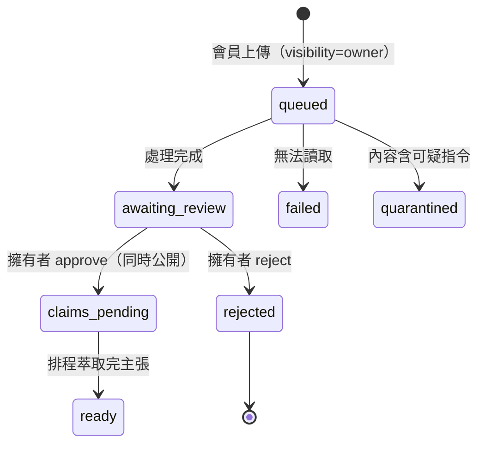

# 使用者權限：會員只能上傳報告和做 /learn

2026-11-03。Keycloak 開放自行註冊（註冊頁會回傳表單），而當時「只要登入」就能做很多事：寫公開的 AI 分析、改產業分組、
讀 RunPod 費用、新增／修改／刪除 People／Weapons／Gallery／People Images／`/api/**`、儲存 CKEditor 內容、用個人日記 API。
新規則：**新註冊的帳號只能上傳報告（先審核後公開）和做 /learn 題目，其他全部只有擁有者（`manage-users`）能做。**

## 角色

| 角色 | 來源 | 能做什麼 |
|---|---|---|
| `manage-users`（擁有者） | 你自己的帳號 | 全部：寫分析、審核報告、管理資料、看使用者與活動 |
| `member`（會員） | Keycloak 預設角色，註冊就有 | 上傳報告（私有，等審核；每天 5 份）、做 /learn、看自己的通知已讀 |
| 只登入、沒有上面兩個角色 | 理論上不該存在 | 什麼都不能做（`require_member_request` 回 403） |
| 排程（agent key） | `X-Market-Agent-Key` | 不變：寫 AI 分析、萃取主張、審核 GPT 提案 |

```mermaid
flowchart TD
    Reg[自行註冊 Keycloak] --> M[member 預設角色]
    M --> Up[POST /market/reports<br/>會員：強制 visibility=owner，每天最多 5 份]
    Up --> Proc[背景處理：抽文字、內容隔離審查、向量化]
    Proc --> Held[status=awaiting_review<br/>只有上傳者自己看得到<br/>不進主張萃取、公開列表、觀察名單]
    Held --> Q[擁有者 GET /market/reports/review-queue]
    Q -->|approve| Pub[visibility=public, status=claims_pending<br/>進入每日 20:30 主張萃取]
    Q -->|reject| Rej[status=rejected，仍只有上傳者看得到]
    M --> Learn[/learn：每次作答回報 maya-sawa]
    Up --> Log[(maya_sawa_user_activity<br/>追加式：誰、做了什麼 C/R/U/D、資源、時間)]
    Pub --> Log
    Learn --> Log
    Owner[擁有者 GET /market/admin/users<br/>與 /admin/users/sub/activity] --> Log
```



## 使用者與活動紀錄（`maya_sawa_user`、`maya_sawa_user_activity`）

- Keycloak 仍是身分來源；`maya_sawa_user` 只記 `sub`、使用者名稱、第一次與最後一次出現（**不存 email、密碼、token**）。
- `maya_sawa_user_activity` 是**追加式**：只有 `record()`，應用程式沒有更新或刪除的方法。欄位：`sub`、`username`、`action`（C 新增／R 讀取／U 修改／D 刪除）、
  `resource_type`、`resource_id`、`detail`（JSON，≤1000 字）、`request_id`、`at`。
- 寫入來源：報告上傳（C）、審核（U，記在擁有者名下，detail 有 `uploader`）、刪除（D）；/learn 開始作答（C `learn-session`）、交卷（C `learn-attempt`，附分數、題數、秒數）、
  看檢討（R `learn-review`）。重複上傳同一份檔案不算第二次新增、也不占額度。
- 擁有者讀取：`GET /market/admin/users`、`GET /market/admin/users/{sub}/activity`、`GET /market/admin/activity`（皆可用 `limit`、`before_id` 翻頁）。
- /learn 在 Java 後端：`UserActivityReporter` 以背景執行緒呼叫 `POST /market/internal/activity`（`X-Internal-Secret`），失敗只記警告，不影響答題；
  設定 `USER_ACTIVITY_URL` 與 `MARKET_INTERNAL_SECRET`（沒設就什麼都不做）。

## 你要在 Keycloak 做的事（我沒有權限，也不該改安全設定）

1. Realm roles 建立 `member`。
2. Realm settings → User registration → Default roles，把 `member` 加進去（之後每個註冊的帳號都有）。
3. **現有**已註冊的帳號不會自動拿到：在 Users 裡逐一加 `member`，或接受他們暫時什麼都不能做。
4. 建議同時打開 Realm settings → Login → **Verify email**，並確認 email 設定能寄信，減少隨意註冊。
5. 在部署之前，如果想先擋住新註冊，可暫時關閉 User registration。

## 開發方法

1. 先查實際權限：Keycloak 註冊頁（GET 一個回傳 200 的表單）、maya-sawa 每個端點用的依賴（`require_authenticated` 還是 `require_manage_users_request`）、
   Java `SecurityConfig` 的每一條規則（`.authenticated()` 是「任何登入者」）。
2. 先寫失敗測試：Python 角色依賴、會員上傳與審核與額度、擁有者專屬寫入、活動表與管理端點；Java 授權矩陣加三組
   （一般登入者寫入 → 403、預設規則只有擁有者、`/learn/public` 訪客 → 401），確認紅（25 個失敗）再改規則。
3. 規則改成預設拒絕：Java 把寫入改 `hasRole("manage-users")`、預設規則 `anyRequest().hasRole("manage-users")`，`/learn/**` 維持「登入即可」。
   內部寫入 token 帶 `ROLE_manage-users`，服務之間的呼叫不受影響。
4. 因此必須改的既有測試是刻意的契約變更，不是放寬：舊測試用一般登入者做寫入並期待成功，改成擁有者身分；仍要驗證「一般登入者被拒絕」的測試維持 `user()`。
5. 會員上傳用既有的 `visibility=owner`（只有上傳者看得到）加新狀態 `awaiting_review`，**沒有改資料表結構**（`create_all` 不會改既有表）。
6. 部署順序：maya-sawa 與 Java 後端都部署、再在 Keycloak 建 `member` 並設為預設角色；前端上傳與審核畫面另做。

## 測試

- maya-sawa：`poetry run python -m pytest tests/security tests/market -q`（我新增的：`tests/security/test_user_activity.py`、`test_member_auth.py`、`test_owner_only_writes.py`、
  `test_admin_users.py`，`tests/market/reports/test_member_reports.py`）。
- Java：`mvn -o test`（476 個通過；新增 `UserActivityReporterTest`、`LearnControllerWebTest` 的活動回報案例、`SecurityRulesWebTest` 的三組新規則）。
- 前端：`tests/learn/learnRequest.test.ts`（訪客路徑已移除，沒登入就丟 `LoginRequiredError` 並顯示登入提示）。

## 已知缺口（誠實）

- **前端還沒有**：會員的上傳表單與「等待審核」狀態、擁有者的審核佇列、使用者／活動檢視畫面。後端 API 都已就緒。
- 還沒實測：Postgres 建表（`maya_sawa_user`、`maya_sawa_user_activity`）、Java 到 maya-sawa 的內部呼叫、`member` 預設角色、真實註冊流程。
- 活動紀錄只涵蓋上面列的動作；其他後端（People／Weapons／Gallery 的寫入）現在只有擁有者能做，尚未接進活動紀錄。
- 其他 `maya-sawa` 路由（例如 articles／blog／people／voyeur）我只查了用 `require_authenticated` 的那幾個，沒有逐條稽核；建議再做一輪。
- 審核沒有通知：擁有者要去看佇列；之後可以接 Telegram。
