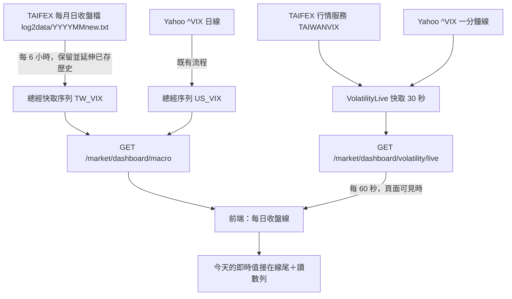

# 台灣 VIX 與美國 VIX（總經頁最上方，即時更新）

2026-11-16。總經頁最上方、場內／場外利率圖之上，左邊「台指選擇權波動率指數（台灣 VIX）」、右邊「美國 VIX」。每張圖是已存的每日收盤線，加上今天的即時值當最新一點，圖上方一行顯示即時值、漲跌、當日開高低與時間，約每分鐘更新。

## 資料來源

| 項目 | 來源 | 備註 |
|---|---|---|
| 台灣 VIX 日收盤 | 期交所每月檔（Big5 文字），取「收盤前 1 分鐘均值」 | 網站只留約 4 個月，所以歷史存在總經快取並逐次延伸 |
| 台灣 VIX 即時 | 期交所行情服務 `mis.taifex.com.tw/futures/api/getQuoteDetail`，`SymbolID: TAIWANVIX` | 約 15 秒更新；含開高低與前收 |
| 美國 VIX 日收盤 | 既有 `US_VIX`（Yahoo） | 每 5 小時 |
| 美國 VIX 即時 | Yahoo `^VIX` 一分鐘線 meta | 休市時回最近一次收盤 |

兩個即時來源都不是官方 API；失敗時該欄為 `null`，前端沿用上一次讀數與日收盤線，其他功能不受影響。

## 開發方法

- 解析與快取寫成純函式／小類別（`maya_sawa/services/volatility.py`），用真實回應做 fixture：`tests/market/macro/test_volatility_live.py`。
- `TW_VIX` 進 `FREE_CACHE_CODES`，沿用 `_cache_free_series`（重啟後可從資料庫還原）與 `reserve_source_call("TAIFEXVix")` 額度。
- 前端 `macroLive.ts` 的 `withLivePoint`／`liveReadout` 為純函式，`tests/market/macroVolatility.test.ts` 先寫；圖版面常數在 `macroLayout.ts` 的 `MACRO_VOLATILITY_CHARTS`。
- 前端經 `/api/market/dashboard/volatility/live` 轉送，每分鐘輪詢，頁面隱藏時暫停。
