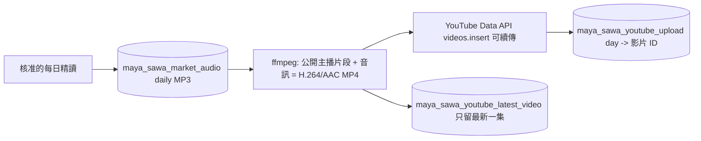

# 每日精讀自動上傳 YouTube

每日精讀核准、語音產生後，maya-sawa 自動把音訊做成 MP4 並上傳 YouTube。音訊來自資料庫，不經站內 API、不經 AI。

- **每 10 分鐘檢查一次**（`main._youtube_daily_loop`）：已核准且還沒上傳的最新 3 集（第一次部署補最近三集，之後每天一集），音訊還沒好的下一輪再試。
- **不重複上傳**：上傳成功立刻在 `maya_sawa_youtube_upload` 記錄日期與影片 ID，重啟也不會重傳。
- **資料庫只留最新一集的 MP4**（`maya_sawa_youtube_latest_video` 單列，每次覆蓋）；其他集的 MP4 不保存。
- 標題為「MM/DD｜每集標題」，說明欄放閱讀版摘要、文字版連結（/work/daily-reading-日期）、資料來源網址與免責聲明；分類為教育，不是兒童內容。
- **影片畫面用 Learn 頁公開的主播片段**（`tymultiverse.cc/images/people/`）：Maya 日用 `reporter.mp4`、`reporter2.mp4`… 依網站播放器相同的順序（0,1,2,0,3,4,0,…）接起來直到涵蓋整段語音；週二、週日（Duo）用 `reporterDuoUiobbeci.mp4`，抓不到時退回 `reporterDuo.mp4`／`reporter.mp4`。這是沒有權限的訪客看到的版本，**絕不使用只有完整主播權限者才看得到的 `prison*` 系列**。**原則：YouTube 的畫面和 Learn 頁對沒有完整主播權限的人看到的完全一樣。** Learn 頁那個畫面框是 32:9、深色底，影片高度 200%、頂端對齊，所以只露出上半部（`learn.css` 的 `data-full="false"`）。YouTube 影片就是這個畫面本身：片段先置入 16:9 框、只保留上半部，輸出 1920x540，周圍不加任何東西，下半身不會出現。 ffmpeg 已在映像裡。
- 每集記錄影片版本（`VIDEO_VERSION`）；改版本號會讓最新幾集用新畫面重傳（舊影片需到 YouTube 工作室手動刪除，上傳權限不含刪除）。

## 啟用（需要頻道擁有者授權，程式無法代做）

1. Google Cloud 建立專案，啟用 YouTube Data API v3，建立 OAuth 用戶端，並用 `youtube.upload` 範圍為頻道取得 refresh token（上傳者必須是該頻道的擁有者或管理者）。
2. 建立 secret（欄位皆選填，缺任一個或 `YOUTUBE_UPLOAD_ENABLED` 不是 true 就維持關閉）：
   `kubectl create secret generic youtube-upload --from-literal=YOUTUBE_CLIENT_ID=... --from-literal=YOUTUBE_CLIENT_SECRET=... --from-literal=YOUTUBE_REFRESH_TOKEN=... --from-literal=YOUTUBE_UPLOAD_ENABLED=true --from-literal=YOUTUBE_PRIVACY=private`
3. 重啟 maya-sawa。**先用 `private` 看一集，確認頻道、畫面、聲音與說明沒問題**，再把 `YOUTUBE_PRIVACY` 改成 `public`（`unlisted` 為不公開列出）。拼錯可見性會退回 `private`，不會誤公開。
4. 注意：未通過 Google 稽核的 API 專案，用 API 上傳的影片可能被鎖成私人；若發生，需要申請 YouTube API 稽核。
5. `videos.insert` 每次約耗 1,600 配額單位，預設每日 10,000，每天一集綽綽有餘；補三集不會超額。

開發方法：先用假的 YouTube 用戶端與假的 ffmpeg 測重複、順序與只留最新一集，再用真 ffmpeg 驗證輸出是 H.264 + AAC；`poetry run python -m pytest tests/market/test_youtube_daily.py -q`。

## 主播對應（2026-11-16 修正）

影片裡的主播由**資料庫裡那集語音的 `voice`** 決定，規則與 Learn 頁 `presenterForAudio` 完全相同：`duo:*` 是 Duo、`zh-CN-XiaoyiNeural` 等是 Uiobbeci、其他（Xiaoqi 等）是 Maya。曾經把所有非 Duo 都當成 Maya，導致 Uiobbeci 的集數（如 11/14）配上 Maya 的畫面。

| 主播 | 聲音 | 畫面片段 |
|---|---|---|
| Maya | `zh-CN-Xiaoqi:DragonHDFlashLatestNeural` | `reporter.mp4`、`reporter2.mp4`… 依網站順序 |
| Uiobbeci | `zh-CN-XiaoyiNeural` | `reporterUiobbeci.mp4`（無備援，缺片段就不上傳，不用別人頂替） |
| Duo | `duo:uiobbeci:maya-pending` | `reporterDuoUiobbeci.mp4`，缺時退回 `reporterDuo.mp4` |

Uiobbeci 的集數以自己的版本標記（`presenter-top-half-2-uiobbeci`）記錄，所以舊的錯誤上傳會被偵測到並重傳。

## 失敗通知（2026-11-16）

上傳失敗時發 Telegram（第一次失敗立刻發，持續失敗兩小時後再發一次），之後每小時重試（見下節）。授權過期（測試狀態的 OAuth 應用約 7 天）會以這個通知呈現。

## ffmpeg 不能跟 API 搶 CPU（2026-11-17）

節點只有 1 顆 vCPU。`veryfast` 合成一集超過 30 分鐘上限（`TimeoutExpired`），期間吃滿 CPU，`/healthz` 逾時，maya-sawa 被 kubelet 殺掉重啟；失敗後每 10 分鐘重試，又再搶一次。現在：

- ffmpeg 以 `nice -n 19` 執行（容器裡有 `nice` 才加），API 永遠優先拿到 CPU。
- 預設 `-preset ultrafast`，合成上限 3 小時（`ENCODE_TIMEOUT_SECONDS`）。
- 失敗後改為每小時重試（`retry_delay_seconds`），Telegram 第一次失敗立刻通知、第三次（約兩小時後）再通知一次。

開發方法：`tests/market/test_youtube_daily.py` 測指令前綴、preset、逾時與重試間隔；兩個真 ffmpeg 測試確認輸出仍是 1920×540 H.264/AAC。
